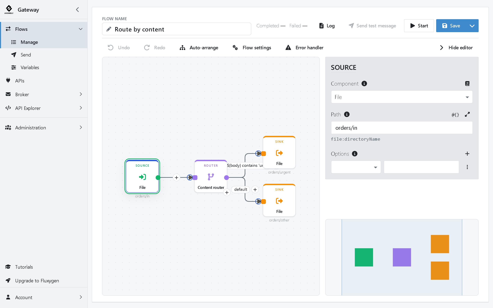

# Assimbly Gateway

[](https://github.com/assimbly/gateway/releases/latest)
[](https://hub.docker.com/r/assimbly/gateway-full)
[](LICENSE)

**Design, run and manage integrations in your browser.** Connect files, databases, queues and APIs with Flows you build
on a canvas, without writing code. Powered by [Apache Camel](https://camel.apache.org/) and
[Apache ActiveMQ](https://activemq.apache.org/).



## Features

- **Visual Flows**: build a Flow Step by Step on a canvas, or start from an Example Flow.
- **Script and Route Flows**: write a script or a Camel route when that's quicker.
- **Every Apache Camel component**: File, SFTP, HTTP, Kafka, databases and hundreds more, all set up the same way.
- **APIs**: design a REST API, handle each Operation with a Flow, and get its OpenAPI document for free.
- **Built-in broker**: run ActiveMQ inside the Gateway and manage its queues and topics.
- **Tutorials inside the Gateway**: learn by doing, with each step checked for you.
- **Secure by default**: its own keys on first start, encrypted secrets, no open registration.

## Quick start

1. **Download and click (Windows & Mac — no Java install needed)**:
   Download the **Windows** (`.zip`) or **Mac** (`.tar.gz`) bundle from the [latest release](https://github.com/assimbly/gateway/releases/latest), unpack it, and double-click **`Assimbly`** (`Start Assimbly.bat` on Windows, `Start Assimbly.command` on Mac). A terminal window opens, and after a few seconds your browser opens **[http://localhost:8080](http://localhost:8080)** automatically.

2. **Or run with Docker** (`amd64` and `arm64`):
   ```bash
   docker run -p 8080:8088 -p 9001:9001 -v assimbly-data:/data assimbly/gateway-full
   ```

3. **Or run the JAR** (requires **Java 25** or newer):
   ```bash
   java -jar gateway-6.0.0.jar
   ```

Sign in at **[http://localhost:8080](http://localhost:8080)** with `admin` / `admin` and choose your own password. Then click **Tutorials** in the top menu and run your first Flow in five minutes.

Need help? See the [Install guide](docs/install.md) and the [Quick start](https://github.com/assimbly/gateway/wiki/quick-start).

## What's new in 6.0

- A visual Flow designer replaces the linear Flow editor.
- Design and run REST APIs in the Gateway.
- Interactive tutorials inside the Gateway.
- Secure by default for new installs.
- Export Flows for [Fluxygen](docs/migrate-to-fluxygen.md).
- Java 25, Spring Boot 4 and Angular 22.

**Upgrading from 5.x?** Install Java 25 first. On its first start the Gateway generates its keys in
`.assimbly/security` in your home folder (`/data` with Docker): back that folder up with your database. Registration
is off: an administrator adds users under **Administration → Users**.

See the [release notes](https://github.com/assimbly/gateway/releases) for everything that changed.

## Documentation

- [Quick start](https://github.com/assimbly/gateway/wiki/quick-start): install and run your first Flow
- [Tutorials](https://github.com/assimbly/gateway/wiki/tutorials): Flows, request/reply, queues, routes, APIs and the
  broker
- [Migrate to Fluxygen](docs/migrate-to-fluxygen.md): hand your Flows over to hosted Fluxygen
- [Wiki](https://github.com/assimbly/gateway/wiki): components, connections, Docker, environment variables and more

## Build from source

```bash
git clone https://github.com/assimbly/gateway.git
cd gateway
./gradlew
```

This builds the Gateway and starts it. See [CONTRIBUTING.md](CONTRIBUTING.md) for how to work on the code.

## Get help and contribute

Found a bug or have an idea? [Open an issue](https://github.com/assimbly/gateway/issues). Contributions are welcome:
start with [CONTRIBUTING.md](CONTRIBUTING.md).

## License

Assimbly Gateway is licensed under the [Apache License 2.0](LICENSE).
