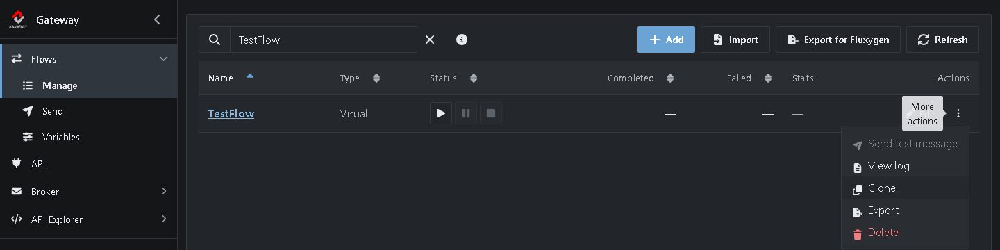
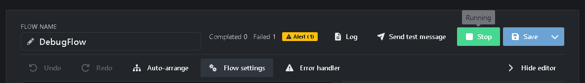
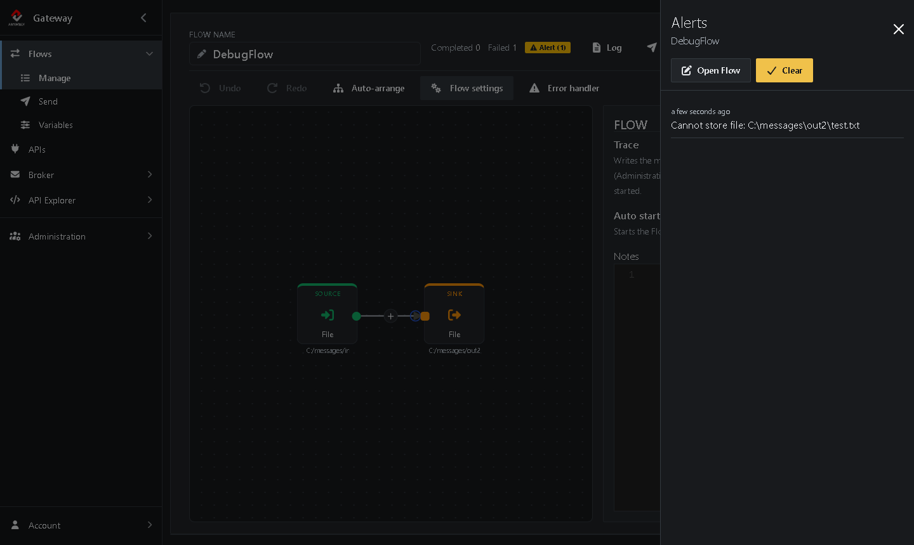
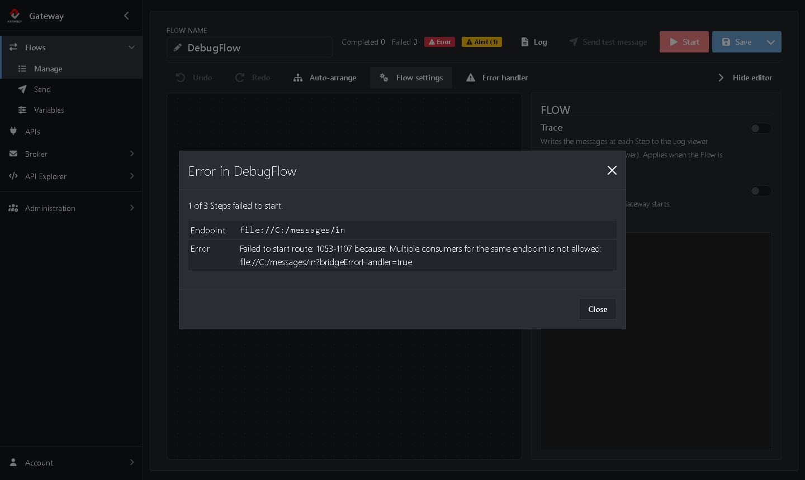

# Tutorial 1: Your first Flow and debugging it

<!-- tutorial: {"id":"tutorial1","title":"Tutorial 1: Your first Flow and debugging it","minutes":20} -->

In the first part of this tutorial you build *TestFlow*, a Flow that moves files from one folder to another, and watch a file go through. In the second part you break a copy of it on purpose and find out what went wrong. You learn where Assimbly Gateway 6 shows errors: the counters and alerts in the editor, the log and the error details of a Flow that doesn't start.

**What you'll do:**

*Part 1: Build a Flow*

1. Prepare two folders
2. Create *TestFlow*
3. Start it and send a file

*Part 2: Debug a Flow*

4. Clone *TestFlow*
5. Change its Sink so it can't deliver files
6. Send a file and watch it fail
7. Find the full error in the log
8. Find out why a Flow doesn't start

It takes about 20 minutes.

<!-- web-only -->
> You can also follow this tutorial inside the Gateway: click **Tutorials** in the menu. It shows each step next to the screen it's about and ticks it off once you've done it.

## Before you start

* Complete the [Quick start](https://github.com/assimbly/gateway/wiki/quick-start). You need the Gateway running and to be signed in.
* Make sure the folder `C:\messages\out2` does **not** exist. Part 2 relies on it being missing.

> On Linux or macOS, use `/home/<you>/messages/...` wherever this tutorial says `C:/messages/...`. Running the Gateway with Docker? It only sees folders you mount into the container: add `-v <your folder>/messages:/messages` to the `docker run` command and use `/messages/in`, `/messages/out` and `/messages/out2` as paths.

## Part 1: Build a Flow

You build *TestFlow*: it picks up each file from an `in` folder and drops it in an `out` folder. The other tutorials start from this Flow too.

## Step 1: Prepare two folders

Create the `in` and the `out` folder:

**Windows (PowerShell)**

```powershell
mkdir C:\messages\in, C:\messages\out
```

**Linux / macOS**

```bash
mkdir -p ~/messages/in ~/messages/out
```

## Step 2: Create TestFlow

<!-- step: {"check":"flowExists:TestFlow"} -->

1. Go to **Flows → Manage** and click **Add**. <!-- show: [aria-label="Add"] -->
2. Choose **Visual** (marked *No code · recommended*). <!-- show: a.flow-type-choice -->
3. Next to **Flow name** at the top, type `TestFlow`. <!-- show: #field_flowName -->
4. Click the **Source** on the canvas. <!-- show: .flow-step-source --> A panel opens on the right where you configure it. (Don't see the panel? Click **Show editor**.) <!-- show: [aria-controls="flow-designer-panel"] -->
   * **Component:** `File`
   * **Path:** the `in` folder, as a full path. Use forward slashes, also on Windows: `C:/messages/in` or `/home/<you>/messages/in` <!-- show: [formcontrolname="uri"] -->
5. Click the **+** after the Source and add a **Sink**: <!-- show: .flow-plus -->
   * **Component:** `File`
   * **Path:** the `out` folder: `C:/messages/out` or `/home/<you>/messages/out`
6. Click **Save**. <!-- show: [data-tour="flow-save"] -->

You now have a Flow of two Steps: a Source that receives messages and a Sink that delivers them.

**Good to know**

* A Flow that isn't complete yet, for example a Source without a Sink, is saved as a **Draft**. It shows a *Draft* badge in the header and can't be started until it's finished. Hover over the badge to see what is missing.
* Errors are handled by the Flow's **Error handler**. For a new Flow it writes the error to the Gateway log. You can change it from the toolbar of the editor.

## Step 3: Start it and send a file

<!-- step: {"check":"flowCompleted:TestFlow"} -->

1. Click **Start** at the top right of the editor. <!-- show: [data-tour="flow-start"] --> The button turns green once the Flow is running. (Or use **Save & start** from the menu next to **Save**.)
2. Put a text file in your `in` folder, for example:

   **Windows (PowerShell)**

   ```powershell
   "Hello Assimbly" | Out-File C:\messages\in\test.txt
   ```

   **Linux / macOS**

   ```bash
   echo "Hello Assimbly" > ~/messages/in/test.txt
   ```

3. Within a second the file is picked up by the Source and appears in the `out` folder.

In the editor header, the **Completed** counter goes up by one. <!-- show: [data-tour="flow-completed"] -->

> Camel's File component moves the files it has picked up to a hidden `.camel` subfolder of the `in` folder, so the same file is not processed twice.

## Part 2: Debug a Flow

*TestFlow* works. Now you make a copy that can't deliver its files, and find out what went wrong.

## Step 4: Clone the TestFlow

<!-- step: {"check":"route:mode=clone"} -->

1. Go to **Flows → Manage**.
2. In the row of *TestFlow*, click **⋮** (*More actions*) <!-- show: tr[data-flow-name="TestFlow"] [aria-label="More actions"] --> and choose **Clone**.



The editor opens with a copy of *TestFlow*. Everything is copied except the name, which is empty.

## Step 5: Make the Sink fail

<!-- step: {"check":"flowExists:DebugFlow"} -->

Change the copy so it can't deliver its files:

1. Next to **Flow name**, type `DebugFlow`. <!-- show: #field_flowName -->
2. Click the **Sink** on the canvas. <!-- show: .flow-step-sink --> Its settings open in the panel on the right. (Don't see the panel? Click **Show editor**.)
3. Change **Path** to `C:/messages/out2`. <!-- show: [formcontrolname="uri"] -->
4. Under **Options**, choose **Auto Create** in the list and turn the switch **Off**. <!-- show: .option-row -->


5. Click **Save**. <!-- show: [data-tour="flow-save"] -->

Normally the File component creates a missing folder for you. With **Auto Create** off it can't, so every file this Flow tries to deliver fails.

## Step 6: Send a file and watch it fail

<!-- step: {"check":"flowFailed:DebugFlow"} -->

1. Stop *TestFlow*: it still runs from part 1, and it would pick up the file before *DebugFlow* can. Go to **Flows → Manage** and click **■** in its row. <!-- show: tr[data-flow-name="TestFlow"] [aria-label="Stop"] -->
2. Open *DebugFlow* and click **Start**. <!-- show: [data-tour="flow-start"] --> The button turns green once the Flow is running.
3. Put a text file in the `in` folder:

   **Windows (PowerShell)**

   ```powershell
   "Hello Assimbly" | Out-File C:\messages\in\test.txt
   ```

   **Linux / macOS**

   ```bash
   echo "Hello Assimbly" > ~/messages/in/test.txt
   ```

The Source picks up the file, but the Sink can't store it. In the editor header the **Failed** counter goes up <!-- show: [data-tour="flow-failed"] --> and a yellow **Alert** badge appears:



4. Click the **Alert** badge. <!-- show: [data-tour="flow-alert-badge"] --> The *Alerts* panel lists the errors of this Flow:



`Cannot store file: C:\messages\out2\test.txt` tells you exactly what went wrong: the Sink can't write to the `out2` folder. Click **Clear** to remove the alerts once you've read them.

> **Where did my file go?** The Flow's **Error handler** takes care of failed messages. By default it writes the error to the Gateway log, after which the file is moved to the hidden `.camel` subfolder of the `in` folder, just like a file that was delivered. To do something else with failed messages, click **Error handler** in the editor toolbar.

## Step 7: Find the full error in the log

<!-- step: {"check":"flowLog:DebugFlow:Cannot store file"} -->

An alert is a one-line summary. The full details, such as the headers of the message and the stack trace, are in the Gateway log. You see the log in the terminal where you started the Gateway, or in your browser:

1. In the editor header of *DebugFlow*, click **Log**. <!-- show: [data-tour="flow-log"] --> A panel opens with the log of this Flow only.
2. Type `Cannot store file` in the filter box. <!-- show: #flowLogSearchText -->


You find two entries:

* The first is written by the Flow's error handler. It shows the failed message: its headers, its body and the exception that was caught, followed by the stack trace.
* The second says **Failed delivery** and gives the exception: `GenericFileOperationFailedException: Cannot store file`.

> The panel shows the last entries of the log (the **Entries** field). Can't find the error? Raise **Entries**, or drop another file in the `in` folder and click **Refresh**. **Open in Log viewer** shows the same entries in **Administration → Log viewer**, where you can clear the Flow filter to see the whole Gateway log. On **Flows → Manage** you find the same panel under **⋮** → **View log**.

To fix the Flow, you would create the `out2` folder or turn **Auto Create** back on. Leave it broken for now, you need it in the next step.

## Step 8: Find out why a Flow doesn't start

Errors can also happen when a Flow starts. Let's force one:

1. Close the log panel and, in the editor of *DebugFlow*, click **Stop**. <!-- show: [data-tour="flow-stop"] -->
2. Go to **Flows → Manage** and start *TestFlow* with the **▶** button in its row. <!-- show: tr[data-flow-name="TestFlow"] [aria-label="Start"] -->
3. Click *DebugFlow* to open it, and click **Start**. <!-- show: [data-tour="flow-start"] -->

*DebugFlow* doesn't start. Instead a red **Error** badge appears in the header. Click it to see why: <!-- show: [data-tour="flow-error-badge"] -->



Both Flows read from the same folder, `C:/messages/in`. Only one Source at a time may listen to the same file endpoint, so the second Flow can't start: `Multiple consumers for the same endpoint is not allowed`.

When you're done, stop *TestFlow* in **Flows → Manage**.

## Summary

| Where | What it tells you |
|-------|-------------------|
| **Completed** / **Failed** counters | How many messages went through the Flow, and how many failed. |
| **Alert** badge | The latest errors of messages, one line each. |
| **Log** in the editor header (or **Administration → Log viewer**, or the terminal) | The full error, with the message headers and the stack trace. |
| **Error** badge | Why a Flow or one of its Steps didn't start. |

**Done!** You built a Flow and can find out why one fails. Continue with [Tutorial 2: Request/Reply](https://github.com/assimbly/gateway/wiki/tutorial6-request-reply).
