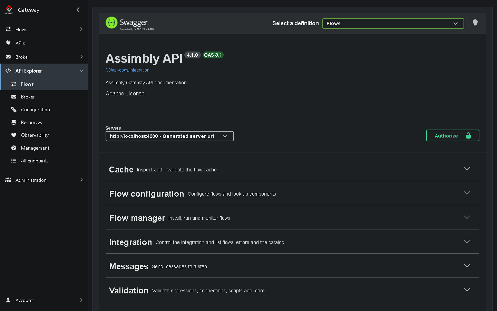
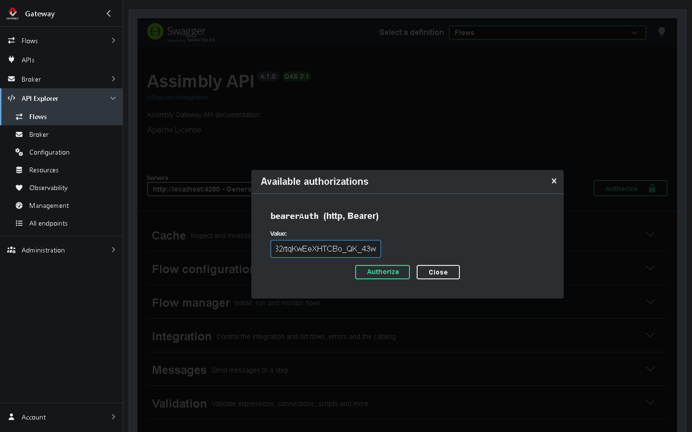
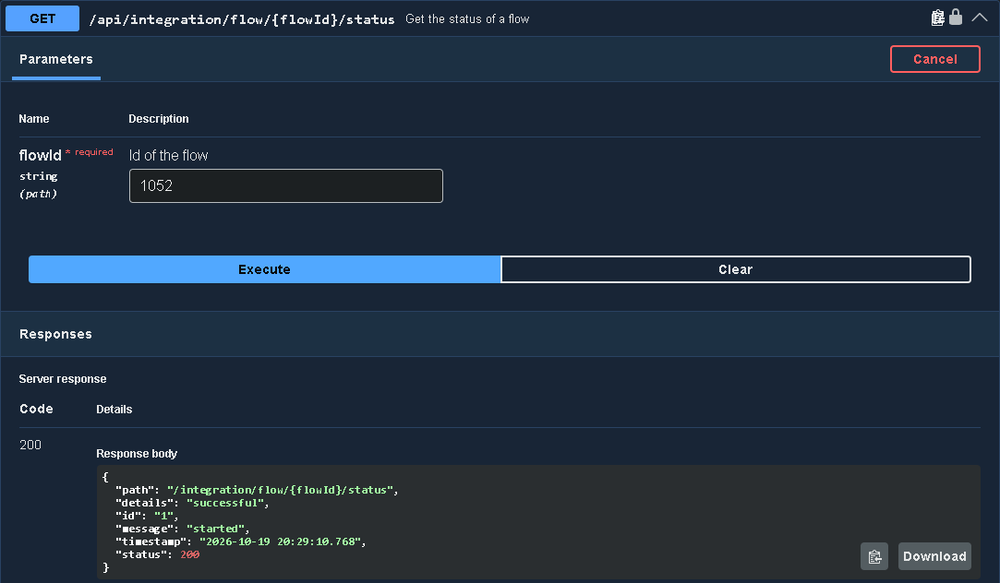
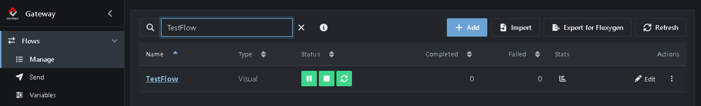

# Tutorial 10: Using the API

<!-- tutorial: {"id":"tutorial10","wiki":"tutorial6-using-the-api","title":"Tutorial 10: Using the API","minutes":15,"track":"Automation"} -->

**What you'll learn**

* Find the Gateway's API documentation
* Log in and get a token
* Start and stop a Flow from the command line

It takes about 15 minutes.

<!-- web-only -->
> You can also follow this tutorial inside the Gateway: click **Tutorials** in the menu. It shows each step next to the screen it's about and ticks it off once you've done it.

## Before you start

* *TestFlow* from [Tutorial 1](https://github.com/assimbly/gateway/wiki/tutorial6-your-first-flow), stopped (see **Flows → Manage**)
* The examples use `http://localhost:8080`, where the Gateway runs by default. Another port? Use yours.

## Step 1: Explore the API documentation

Behind every click in the browser, the browser calls the Gateway's REST API. You can call that API yourself too, from a script, a scheduler or another application: here you start, check and stop a Flow without opening the user interface.

<!-- step: {"check":"route:/explorer/integration"} -->

Click **API Explorer** in the menu on the left <!-- show: #api-menu --> and choose **Flows**. This page lists the endpoints that manage and run Flows, described in [OpenAPI](https://www.openapis.org/) and shown with [Swagger UI](https://swagger.io/tools/swagger-ui/):



* The other entries under **API Explorer**, such as **Broker**, **Configuration** and **Observability**, show the other groups of endpoints. **All endpoints** shows them all. **Select a definition** at the top right switches between the same groups.
* Click a section, such as **Flow manager**, to see its endpoints. Click an endpoint to see its parameters and answers.

Most endpoints that act on a Flow need its **id**. The easiest way to find it: open the Flow in the editor and look at the address bar. For *TestFlow*, the address ends with something like `/flow/editor/1052?...`, so its id is `1052`. Your id will probably be different. Use your own id wherever this tutorial says `1052`.

## Step 2: Log in and get a token

The API is protected. You log in once with your username and password, and get a **token** (a [JSON Web Token](https://jwt.io/introduction)) in return. You send that token along with every following call.

Use the password you chose the first time you signed in (see the Quick start). Replace `your-password` in the commands below with it.

**Windows (PowerShell)**

```powershell
$login = Invoke-RestMethod -Method Post -Uri http://localhost:8080/api/authenticate -ContentType 'application/json' -Body '{"username":"admin","password":"your-password"}'
$headers = @{ Authorization = "Bearer $($login.id_token)"; Accept = '*/*' }
$login.id_token
```

**Linux / macOS**

```bash
TOKEN=$(curl -s -X POST -H 'Content-Type: application/json' -d '{"username":"admin","password":"your-password"}' http://localhost:8080/api/authenticate | sed -n 's/.*"id_token" *: *"\([^"]*\)".*/\1/p')
echo $TOKEN
```

Both print a long string that starts with `eyJ`. That's your token.

> The token expires after a while. When a call answers with **401 Unauthorized**, log in again to get a new one.

## Step 3: Try the API in the browser

Swagger UI can call the API for you, which is a handy way to try an endpoint before you script it.

1. On **API Explorer → Flows**, click **Authorize**.
2. Paste your token under **Value** and click **Authorize**, then **Close**.



3. Open **Flow manager** and click **GET /api/integration/flow/{flowId}/status**.
4. Under **flowId**, replace the example value with your Flow id and click **Execute**.



Under **Response body** you see the answer. The `message` is the status of the Flow: `started` if it runs. A Flow that isn't running answers `unconfigured`.

> Above the response, Swagger UI also shows the `curl` command for the call you just made. Copy it as a starting point for your own scripts.

## Step 4: Start and stop a Flow from the command line

<!-- step: {"check":"flowCompleted:TestFlow"} -->

Use the token from Step 2. Replace `1052` with the id of your *TestFlow*.

The Gateway keeps your Flows in its database, and runs them in its *runtime*. To start a Flow from the API, you hand the runtime the Flow's configuration: first fetch the configuration from the Gateway, then send it to the `install` endpoint. `install` loads the Flow into the runtime and starts it.

**Windows (PowerShell)**

```powershell
$config = (Invoke-WebRequest -UseBasicParsing -Uri http://localhost:8080/api/environment/1/flow/1052 -Headers @{ Authorization = $headers.Authorization; Accept = 'application/xml'; PlaceholderReplacement = 'true' }).Content
(Invoke-RestMethod -Method Post -Uri http://localhost:8080/api/integration/flow/1052/install -Headers $headers -ContentType 'application/xml; charset=utf-8' -Body $config).flow.message
Invoke-RestMethod -Uri http://localhost:8080/api/integration/flow/1052/status -Headers $headers
```

**Linux / macOS**

```bash
curl -s -H "Authorization: Bearer $TOKEN" -H "Accept: application/xml" -H "PlaceholderReplacement: true" http://localhost:8080/api/environment/1/flow/1052 -o testflow.xml
curl -X POST -H "Authorization: Bearer $TOKEN" -H "Content-Type: application/xml" -H "Accept: application/json" --data-binary @testflow.xml http://localhost:8080/api/integration/flow/1052/install
curl -H "Authorization: Bearer $TOKEN" http://localhost:8080/api/integration/flow/1052/status
```

The `install` call answers with a report that contains the message `Started flow successfully`. The `status` call answers `started`.

> **Why not just `start`?** `start` only starts a Flow that the runtime already knows: a Flow that was installed since the Gateway started, for example by clicking **Start** in the browser. After a restart of the Gateway, `start` answers `Flow not found` for such a Flow. `install` always works, because it brings the configuration along.

Now look in the browser: **Flows → Manage** shows *TestFlow* as running, although you never clicked **Start**:



Open *TestFlow*, click **Test** and **Run** a message, like in Tutorial 1. <!-- show: tr[data-flow-name="TestFlow"] td a --> It arrives in the `out` folder of your messages folder: `@{messages}/out`. Then ask the API for the numbers:

**Windows (PowerShell)**

```powershell
(Invoke-RestMethod -Uri http://localhost:8080/api/integration/flow/1052/stats -Headers $headers).flow
```

**Linux / macOS**

```bash
curl -H "Authorization: Bearer $TOKEN" http://localhost:8080/api/integration/flow/1052/stats
```

The answer contains the **completedTransactions** and **failedTransactions** counters: the same numbers you see in the Flow editor, one per message. The **completed** and **failed** fields count the Steps that processed a message, so they're higher when a Flow has more than one Step.

Finally, stop the Flow:

**Windows (PowerShell)**

```powershell
(Invoke-RestMethod -Uri http://localhost:8080/api/integration/flow/1052/stop -Headers $headers).flow.message
```

**Linux / macOS**

```bash
curl -H "Authorization: Bearer $TOKEN" http://localhost:8080/api/integration/flow/1052/stop
```

It answers with the message `Stopped flow successfully`.

> **Why `Accept = '*/*'` in PowerShell?** Without it, Windows PowerShell 5.1 gets **400 Bad Request** from these endpoints. With `*/*`, the same value `curl` sends, the calls work.

## Useful endpoints

All endpoints below start with `http://localhost:8080/api/integration/flow/{flowId}/` and use `GET`, except `install`:

| Endpoint | What it does |
|----------|--------------|
| `install` (`POST`) | Loads the Flow's configuration into the runtime and starts it. |
| `start` / `stop` | Starts or stops a Flow that was installed. |
| `pause` / `resume` | Pauses the Flow and resumes it later. |
| `restart` | Stops the Flow and starts it again. |
| `status` | Tells whether the Flow runs: `started`, or `unconfigured` when it doesn't. |
| `stats` | The counters: `completedTransactions` and `failedTransactions` per message, `completed` and `failed` per Step. |
| `uptime` | How long the Flow has been running. |
| `lasterror` | The last error of the Flow. |

You find many more under **API Explorer**: to manage the broker, import and export Flows, read health and metrics, and so on.

## Summary

| What | Where |
|------|-------|
| API documentation | **API Explorer** |
| Log in | `POST /api/authenticate` with your username and password. The answer contains the token (`id_token`). |
| Call the API | Send the header `Authorization: Bearer <token>` with every call. |
| Find a Flow id | The address bar of the Flow editor, for example `/flow/editor/1052`. |

**Done!** You completed the Assimbly Gateway 6 tutorials. Want to know more? Read the [user guide](https://github.com/assimbly/gateway/wiki/user-guide) and the rest of the [wiki](https://github.com/assimbly/gateway/wiki). Questions or problems? [Open an issue](https://github.com/assimbly/gateway/issues).
