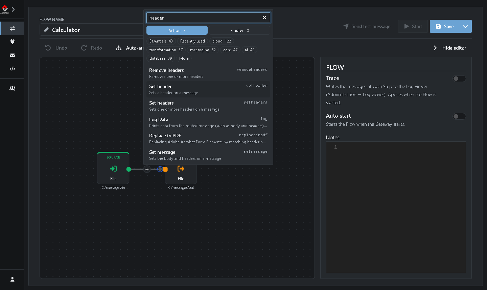
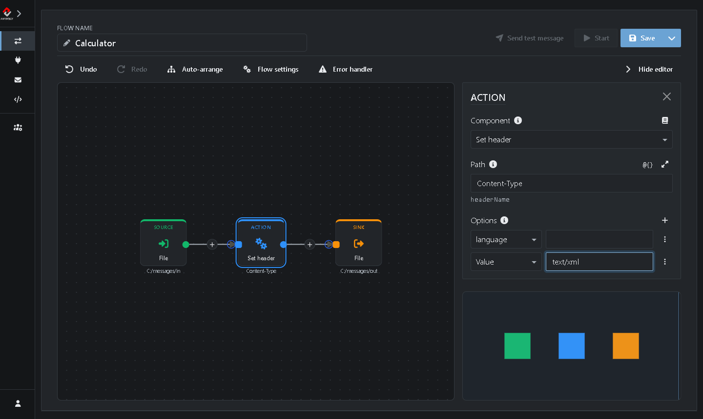
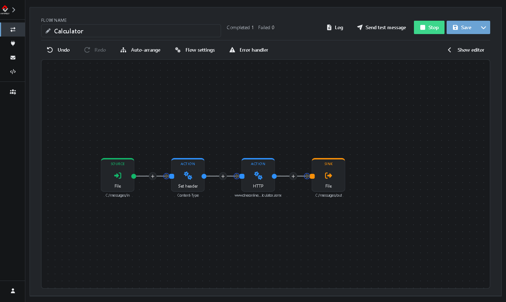

# Tutorial 2: Request/Reply

<!-- tutorial: {"id":"tutorial2","wiki":"tutorial6-request-reply","title":"Tutorial 2: Request/Reply","minutes":10,"track":"Connect systems","fixtures":{"TestFlow":"TestFlow.xml"}} -->

Build a Flow that calls a web service and saves its reply. You ask a public calculator service for 2 + 2 and get the answer back as a file.

In the middle of the Flow, an Action sends the message to the service and waits for the answer. The answer replaces the message, so the Sink saves the reply instead of the request:

**File (Source)** → **Set header** → **HTTP** → **File (Sink)**

It takes about 10 minutes.

<!-- web-only -->
> You can also follow this tutorial inside the Gateway: click **Tutorials** in the menu. It shows each step next to the screen it's about and ticks it off once you've done it.

## Before you start

<!-- step: {"check":"flowExists:TestFlow"} -->

* You need *TestFlow* from [Tutorial 1](https://github.com/assimbly/gateway/wiki/tutorial6-debugging-a-flow): it moves files from `@{messages}/in` to `@{messages}/out`. No *TestFlow*? Click **Add TestFlow** in the Tutorials panel, or import [TestFlow.xml](https://github.com/assimbly/documentation/blob/master/tutorials/v6/tutorial2/TestFlow.xml) with **Import** on **Flows → Manage**.
* The Gateway needs internet access: it calls `www.dneonline.com`.

## Step 1: Clone TestFlow

<!-- step: {"check":"route:mode=clone"} -->

1. Go to **Flows → Manage**.
2. In the row of *TestFlow*, click **⋮** (*More actions*) and choose **Clone**. <!-- show: tr[data-flow-name="TestFlow"] [aria-label="More actions"] -->
3. Next to **Flow name**, type `Calculator`. <!-- show: #field_flowName -->
4. Click the **Source** on the canvas <!-- show: .flow-step-source --> and change **Directory Name** to `@{messages}/calculator`. <!-- show: [formcontrolname="uri"] -->

*Calculator* gets a folder of its own, so *TestFlow* doesn't pick up its requests, even when it runs.

## Step 2: Say the request is XML

The calculator is a SOAP web service. It only accepts a request when its `Content-Type` header says it's XML.

1. Click the **+** on the line between the Source and the Sink. <!-- show: [aria-label="Insert a Step here"] -->
2. Type `header` in the search box and choose **Set header**.



Its settings open on the right:

3. Set **Header Name** to `Content-Type`. <!-- show: [formcontrolname="uri"] -->
4. Under **Options**, type `text/xml` next to **Value**. <!-- show: .option-row + .option-row -->



## Step 3: Call the web service

1. Click the **+** on the line just before the Sink. <!-- show: .flow-step-sink -->
2. Type `http` in the search box and choose **HTTP**.
3. Set **Http Uri** to the address of the service, `http://www.dneonline.com/calculator.asmx`. <!-- show: [formcontrolname="uri"] -->
4. Under **Options**, choose **Http Method** in the list and select **POST**. <!-- show: .option-row -->


You save the Flow in the next step, right before you start it.

## Step 4: Send a request

<!-- step: {"check":"flowCompleted:Calculator"} -->

1. Click **Save**, <!-- show: [data-tour="flow-save"] --> then **Start**. <!-- show: [data-tour="flow-start"] -->
2. Click **Send test message**. <!-- show: [data-tour="flow-send-test"] --> The Send page opens with the Source of *Calculator* as destination.
3. Under **Body**, paste this request. It asks the service to add 2 and 2: <!-- show: .body-codemirror -->

   ```xml
   <soapenv:Envelope xmlns:soapenv="http://schemas.xmlsoap.org/soap/envelope/" xmlns:tem="http://tempuri.org/">
      <soapenv:Header/>
      <soapenv:Body>
         <tem:Add>
            <tem:intA>2</tem:intA>
            <tem:intB>2</tem:intB>
         </tem:Add>
      </soapenv:Body>
   </soapenv:Envelope>
   ```

4. Click **Send**, <!-- show: [title="Send (Ctrl+Enter)"] --> then **Back**.

The Gateway writes the request as a file in the `calculator` folder, and *Calculator* picks it up. Within a few seconds **Completed** goes up. <!-- show: [data-tour="flow-completed"] -->



> **Failed** went up instead? Click the **Alert** badge. `Connect to http://www.dneonline.com:80 failed` means the free service didn't answer in time: send the message again.

## Step 5: Read the reply

The Sink saved the reply in `@{messages}/out`: the `out` folder of your messages folder. On Windows that's `C:\Users\<you>\messages\out`. Not sure where your messages folder is? The Variable `messages` under **Flows → Variables** holds its path, and the Tutorials panel shows it at the top of this step.

Open the newest file in that folder. It holds the reply of the service:

```xml
<soap:Envelope xmlns:soap="http://schemas.xmlsoap.org/soap/envelope/" xmlns:xsi="http://www.w3.org/2001/XMLSchema-instance" xmlns:xsd="http://www.w3.org/2001/XMLSchema">
   <soap:Body>
      <AddResponse xmlns="http://tempuri.org/">
         <AddResult>4</AddResult>
      </AddResponse>
   </soap:Body>
</soap:Envelope>
```

The answer is in `<AddResult>`: 2 + 2 = 4.

Try other numbers with **Send test message**, or change `Add` into `Multiply`, `Subtract` or `Divide` in both tags.

When you're done, click **Stop**. <!-- show: [data-tour="flow-stop"] -->

## Summary

| Step | Component | What it does |
|------|-----------|--------------|
| Source | **File** | Picks up the request from the `calculator` folder. |
| Action | **Set header** | Sets `Content-Type: text/xml`, so the service knows the request is XML. |
| Action | **HTTP** | Sends the request to the service and waits for the reply. The reply becomes the message. |
| Sink | **File** | Saves the reply in the `out` folder. |

**Done!** Continue with [Tutorial 3: Calling a REST API](https://github.com/assimbly/gateway/wiki/tutorial6-calling-a-rest-api).
