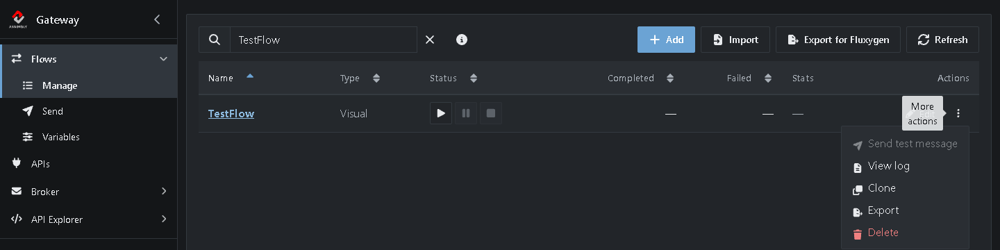
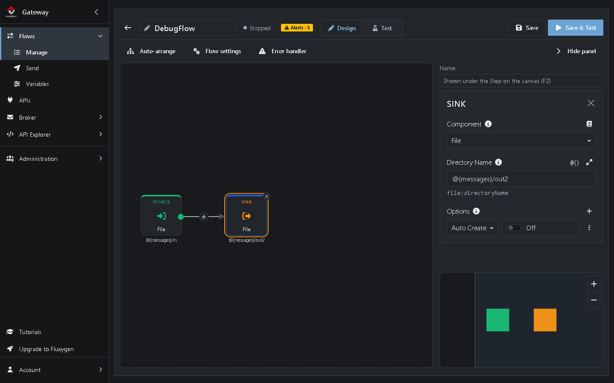
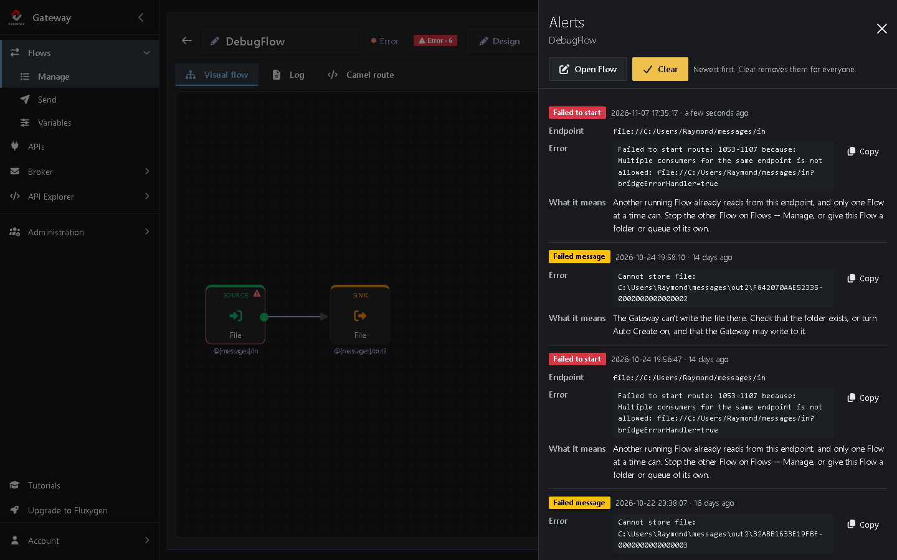
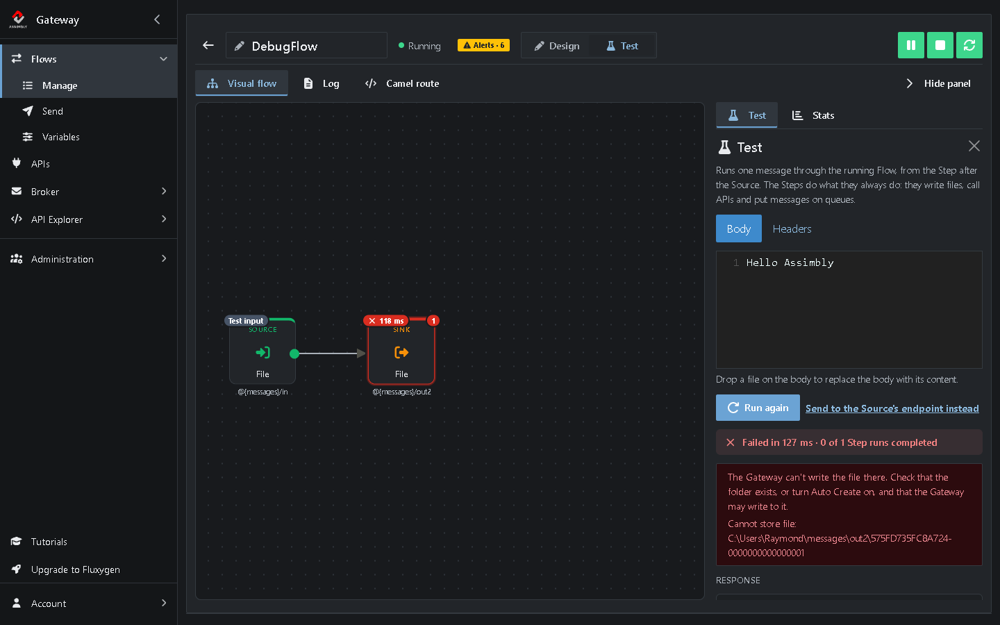
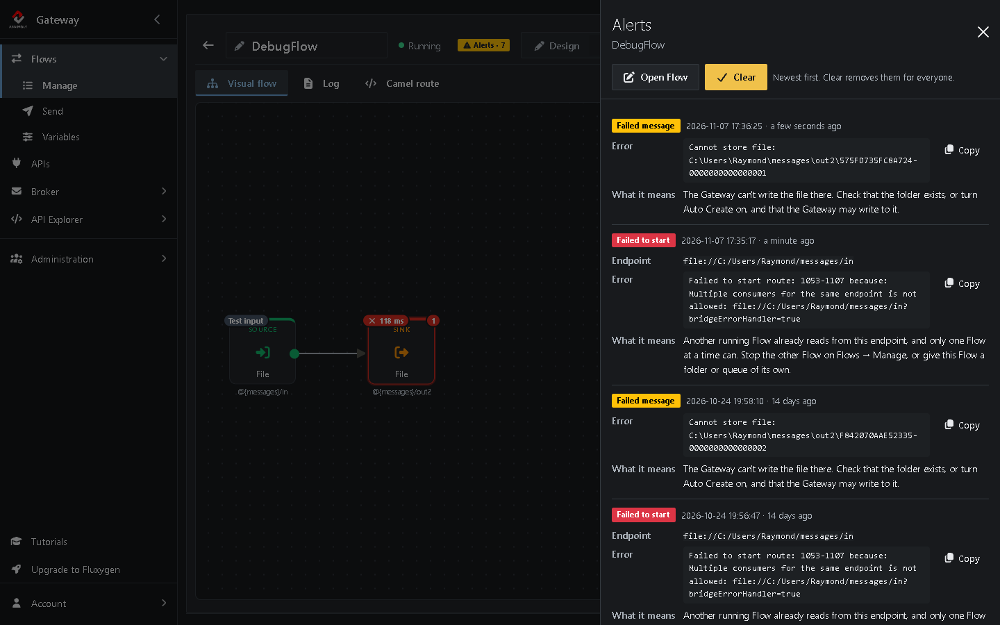

# Tutorial 2: Debugging a Flow

<!-- tutorial: {"id":"tutorial2","wiki":"tutorial6-debugging-a-flow","title":"Tutorial 2: Debugging a Flow","minutes":8,"track":"Get started","fixtures":{"TestFlow":"TestFlow.xml"}} -->

**What you'll learn**

* Find out why a Flow doesn't start
* Spot failed messages: the Tester, stats and alerts

It takes about 8 minutes.

<!-- web-only -->
> You can also follow this tutorial inside the Gateway: click **Tutorials** in the menu. It shows each step next to the screen it's about and ticks it off once you've done it.

## Before you start

* *TestFlow* from [Tutorial 1](https://github.com/assimbly/gateway/wiki/tutorial6-your-first-flow). No *TestFlow*? Click **Add TestFlow** in the Tutorials panel, or import [TestFlow.xml](https://github.com/assimbly/documentation/blob/master/tutorials/v6/tutorial2/TestFlow.xml) on **Flows → Manage**.
* No `out2` folder in your messages folder

## Step 1: Clone the TestFlow

<!-- step: {"check":"route:mode=clone"} -->

You copy *TestFlow* and break the copy on purpose.

1. Go to **Flows → Manage**. Is *TestFlow* stopped? Click **▶** in its row.
2. In the row of *TestFlow*, click **⋮** (*More actions*) <!-- show: tr[data-flow-name="TestFlow"] [aria-label="More actions"] @ / --> and choose **Clone**.

The editor opens with a copy of *TestFlow*, without a name.

> **Why keep TestFlow running?** You need it in step 3, to see why a Flow doesn't start.

## Step 2: Make the Sink fail

1. At the top left, where it says *Flow name*, type `DebugFlow`. <!-- show: #field_flowName -->
2. Click the **Sink** on the canvas. <!-- show: .flow-step-sink -->
3. Change **Directory Name** to `@{messages}/out2`. <!-- show: [formcontrolname="uri"] -->
4. Under **Options**, choose **Auto Create** and turn it **Off**. <!-- show: .option-row -->

> **Why does this fail?** The `out2` folder doesn't exist. Normally the File component creates a missing folder, but with **Auto Create** off it can't. So every file this Flow tries to deliver fails.

> **Tip: where are the settings?** Clicking a Step opens its settings on the right, and **>** at the right of the tabs hides them.

## Step 3: Find out why a Flow doesn't start

<!-- step: {"check":"flowExists:DebugFlow"} -->

1. Click **Save & Test**. <!-- show: [data-tour="flow-save-test"] -->

*DebugFlow* doesn't start: a red **Error** badge appears in the header.

2. Click the **Error** badge. <!-- show: [data-tour="flow-error-badge"] @ flow:DebugFlow --> The *Alerts* panel shows a **Failed to start** alert.

> **Why doesn't it start?** *TestFlow* already reads from `@{messages}/in`, and only one Flow at a time may read from the same folder. That's what the error says: *Multiple consumers for the same endpoint is not allowed*.

> **What's in an alert?** When it happened, the **Endpoint** of the Step that failed, the **Error** itself (with **Copy**) and, for common errors, **What it means**. An alert stays until you clear it, also after you reload the page.

## Step 4: Send a message and watch it fail

<!-- step: {"check":"flowFailed:DebugFlow"} -->

1. Stop *TestFlow*: on **Flows → Manage**, click **■** in its row. <!-- show: tr[data-flow-name="TestFlow"] [aria-label="Stop"] @ / -->
2. Open *DebugFlow*. If it opens in **Design**, click **Test**. <!-- show: [data-cy="mode-toggle"] @ flow:DebugFlow -->
3. Click **▶** (Start). <!-- show: [data-tour="flow-status-controls"] @ flow:DebugFlow:test --> This time the Flow starts.
4. Click the **Tester** tab. <!-- show: [data-cy="test-view-tester"] @ flow:DebugFlow:test -->
5. Under **Body**, type `Hello Assimbly` and click **Run**. <!-- show: [data-cy="test-run"] @ flow:DebugFlow:test -->

The Tester shows **Failed**, with the error. On the **Visual flow** tab the Sink is red; click it to see the error of that Step.

> **Tip: test beside the canvas** Click **>** at the right of the tabs <!-- show: [data-cy="tab-right"] @ flow:DebugFlow:test --> to keep the Tester in a panel beside the canvas, so you see the Sink turn red as you run.

6. Click the **Alerts** badge. <!-- show: [data-tour="flow-alert-badge"] @ flow:DebugFlow --> The newest alert is on top: `Cannot store file: ...messages\out2\...`. The Sink can't write to the `out2` folder.

7. When you're done, click **■** (Stop). <!-- show: [data-tour="flow-status-controls"] @ flow:DebugFlow:test -->

> **Where else do I see failures?** The **Stats** tab <!-- show: [data-cy="test-view-stats"] @ flow:DebugFlow:test --> counts the message under **Failed**. In the *Alerts* panel, **Clear** removes the alerts, for everyone.

> **Where did my message go?** The Flow's **Error handler** takes care of failed messages. By default it writes the error to the Gateway log. To change that, click **Design**, then the **Error handler** tab.

> **How do I fix the Flow?** Create the `out2` folder, or turn **Auto Create** back on.

## Summary

| Where | What it tells you |
|-------|-------------------|
| **Error** badge | The Flow or one of its Steps didn't start. Click it to see why. |
| **Tester** tab | Runs a message through the running Flow and shows the error of the Step that failed. |
| **Stats** tab | How many messages went through the Flow, and how many failed. |
| **Alerts** badge | The errors of this Flow, newest first. They stay until you clear them. |

**Done!** You can find out why a Flow fails. Continue with [Tutorial 3: Calling a REST API](https://github.com/assimbly/gateway/wiki/tutorial6-calling-a-rest-api).
