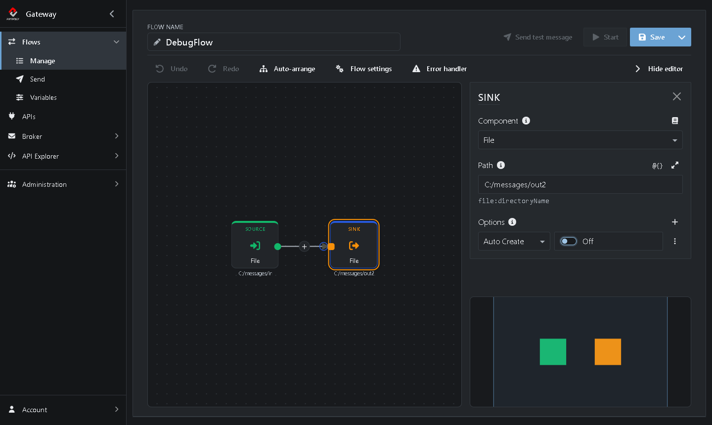
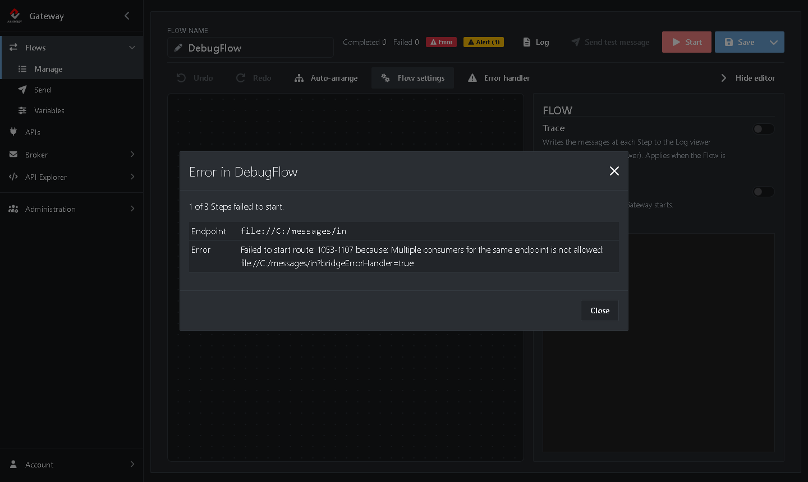
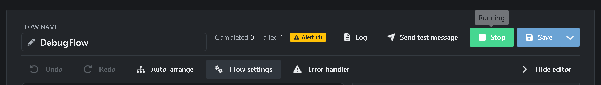
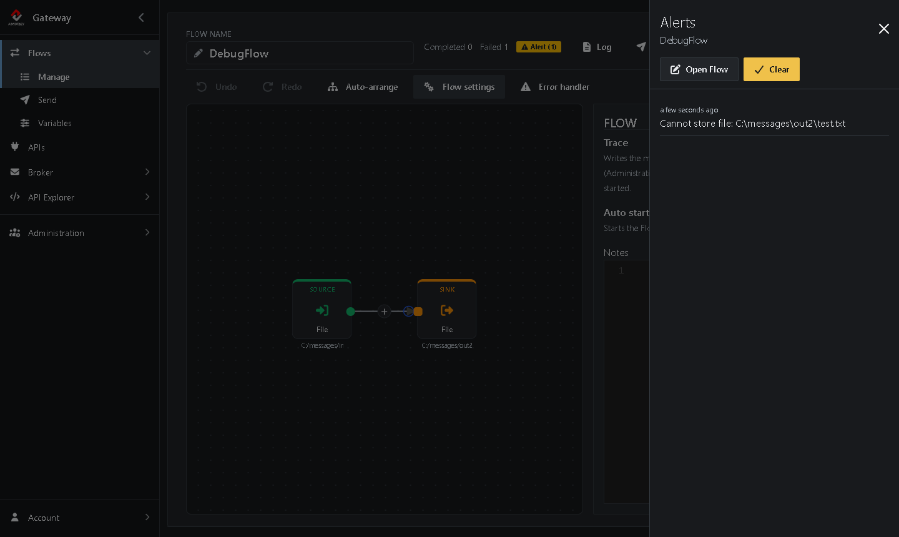

# Tutorial 2: Debugging a Flow

<!-- tutorial: {"id":"tutorial2","wiki":"tutorial6-debugging-a-flow","title":"Tutorial 2: Debugging a Flow","minutes":10,"track":"Get started","fixtures":{"TestFlow":"TestFlow.xml"}} -->

**What you'll learn**

* Find out why a Flow doesn't start
* Spot failed messages: counters and alerts
* Find the full error in the log

It takes about 10 minutes.

<!-- web-only -->
> You can also follow this tutorial inside the Gateway: click **Tutorials** in the menu. It shows each step next to the screen it's about and ticks it off once you've done it.

## Before you start

* *TestFlow* from [Tutorial 1](https://github.com/assimbly/gateway/wiki/tutorial6-your-first-flow). No *TestFlow*? Click **Add TestFlow** in the Tutorials panel, or import [TestFlow.xml](https://github.com/assimbly/documentation/blob/master/tutorials/v6/tutorial2/TestFlow.xml) on **Flows → Manage**.
* No `out2` folder in your messages folder

## Step 1: Clone the TestFlow

<!-- step: {"check":"route:mode=clone"} -->

You make a copy of *TestFlow* that can't deliver its files, and find out what goes wrong.

1. Go to **Flows → Manage**. If *TestFlow* isn't running, click **▶** in its row: you need it running in step 3.
2. In the row of *TestFlow*, click **⋮** (*More actions*) <!-- show: tr[data-flow-name="TestFlow"] [aria-label="More actions"] --> and choose **Clone**.

The editor opens with a copy of *TestFlow*. Everything is copied except the name, which is empty.

## Step 2: Make the Sink fail

Change the copy so it can't deliver its files:

1. Next to **Flow name**, type `DebugFlow`. <!-- show: #field_flowName -->
2. Click the **Sink** on the canvas. <!-- show: .flow-step-sink --> Its settings open in the panel on the right. (Don't see the panel? Click **Show editor**.)
3. Change **Directory Name** to `@{messages}/out2`. <!-- show: [formcontrolname="uri"] -->
4. Under **Options**, choose **Auto Create** in the list and turn the switch **Off**. <!-- show: .option-row -->

Normally the File component creates a missing folder for you. With **Auto Create** off it can't, so every file this Flow tries to deliver fails.

## Step 3: Find out why a Flow doesn't start

<!-- step: {"check":"flowExists:DebugFlow"} -->

Errors can also happen when a Flow starts. *TestFlow* is still running, so you run into one right away:

1. Click **Save**, <!-- show: [data-tour="flow-save"] --> then **Start**. <!-- show: [data-tour="flow-start"] -->

*DebugFlow* doesn't start. Instead a red **Error** badge appears in the header. Click it to see why: <!-- show: [data-tour="flow-error-badge"] -->

Both Flows read from the same folder, `@{messages}/in`. Only one Source at a time may listen to the same file endpoint, so the second Flow can't start: `Multiple consumers for the same endpoint is not allowed`.

## Step 4: Send a message and watch it fail

<!-- step: {"check":"flowFailed:DebugFlow"} -->

1. Stop *TestFlow*, so *DebugFlow* can listen to the `in` folder: go to **Flows → Manage** and click **■** in its row. <!-- show: tr[data-flow-name="TestFlow"] [aria-label="Stop"] -->
2. Click *DebugFlow* to open it, and click **Start**. <!-- show: [data-tour="flow-start"] --> This time the button turns green: the Flow is running.
3. Click **Send test message**, <!-- show: [data-tour="flow-send-test"] --> type `Hello Assimbly` under **Body** and click **Send**. <!-- show: [title="Send (Ctrl+Enter)"] -->
4. Click **Back**.

The Source picks up the file, but the Sink can't store it. In the editor header the **Failed** counter goes up <!-- show: [data-tour="flow-failed"] --> and a yellow **Alert** badge appears:

5. Click the **Alert** badge. <!-- show: [data-tour="flow-alert-badge"] --> The *Alerts* panel lists the errors of this Flow:

`Cannot store file: ...messages\out2\...` tells you exactly what went wrong: the Sink can't write to the `out2` folder. Click **Clear** to remove the alerts once you've read them.

> **Where did my file go?** The Flow's **Error handler** takes care of failed messages. By default it writes the error to the Gateway log, after which the file is moved to the hidden `.camel` subfolder of the `in` folder, just like a file that was delivered. To do something else with failed messages, click **Error handler** in the editor toolbar.

## Step 5: Find the full error in the log

<!-- step: {"check":"flowLog:DebugFlow:Cannot store file"} -->

An alert is a one-line summary. The full details, such as the headers of the message and the stack trace, are in the Gateway log. You see the log in the terminal where you started the Gateway, or in your browser:

1. In the editor header of *DebugFlow*, click **Log**. <!-- show: [data-tour="flow-log"] --> A panel opens with the log of this Flow only.
2. Type `Cannot store file` in the filter box. <!-- show: #flowLogSearchText -->

You find two entries:

* The first is written by the Flow's error handler. It shows the failed message: its headers, its body and the exception that was caught, followed by the stack trace.
* The second says **Failed delivery** and gives the exception: `GenericFileOperationFailedException: Cannot store file`.

> The panel shows the last entries of the log (the **Entries** field). Can't find the error? Raise **Entries**, or send another test message and click **Refresh**. **Open in Log viewer** shows the same entries in **Administration → Log viewer**, where you can clear the Flow filter to see the whole Gateway log. On **Flows → Manage** you find the same panel under **⋮** → **View log**.

To fix the Flow, you would create the `out2` folder or turn **Auto Create** back on.

When you're done, close the log panel and click **Stop**. <!-- show: [data-tour="flow-stop"] -->

## Summary

| Where | What it tells you |
|-------|-------------------|
| **Error** badge | Why a Flow or one of its Steps didn't start. |
| **Completed** / **Failed** counters | How many messages went through the Flow, and how many failed. |
| **Alert** badge | The latest errors of messages, one line each. |
| **Log** in the editor header (or **Administration → Log viewer**, or the terminal) | The full error, with the message headers and the stack trace. |
| **Send test message** in the editor header | Sends a message to the Source of a running Flow, so you can try it without leaving the Gateway. |

**Done!** You can find out why a Flow fails. Continue with [Tutorial 3: Calling a REST API](https://github.com/assimbly/gateway/wiki/tutorial6-calling-a-rest-api).
