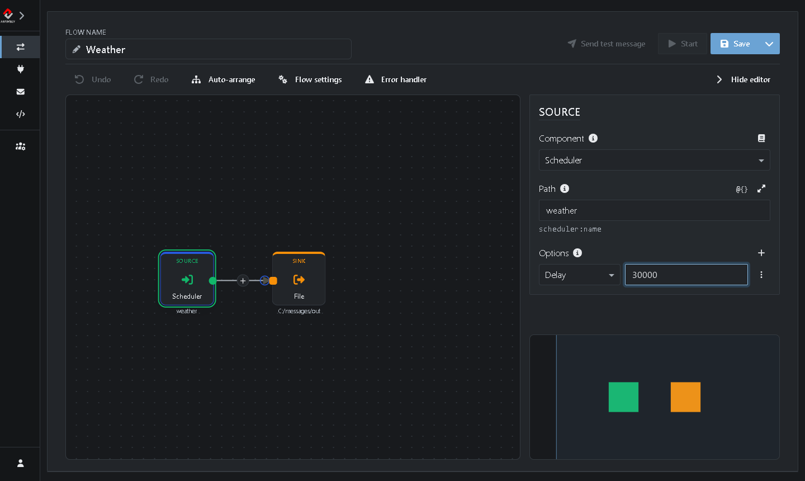
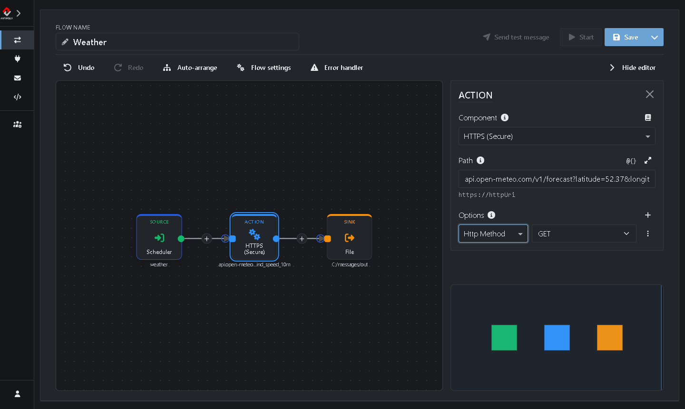
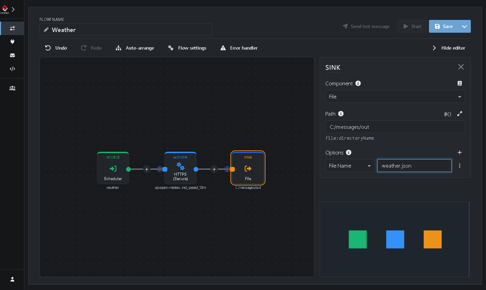
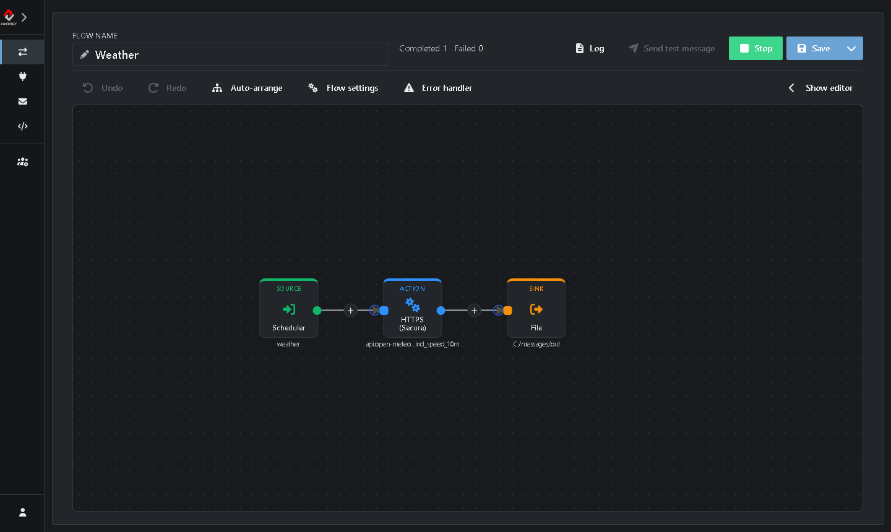

# Tutorial 3: Calling a REST API

<!-- tutorial: {"id":"tutorial3","title":"Tutorial 3: Calling a REST API","minutes":10,"fixtures":{"TestFlow":"TestFlow.xml"}} -->

Build a Flow that calls a REST API on a schedule. Every 30 seconds it asks a free weather service for the current weather in Amsterdam and saves the answer as a JSON file.

A call that fetches data doesn't need a file to start it, only a trigger. A **Scheduler** Source is that trigger: it starts the Flow at a fixed interval with an empty message.

**Scheduler (Source)** → **HTTPS (Action)** → **File (Sink)**

It takes about 10 minutes.

<!-- web-only -->
> You can also follow this tutorial inside the Gateway: click **Tutorials** in the menu. It shows each step next to the screen it's about and ticks it off once you've done it.

## Before you start

<!-- step: {"check":"flowExists:TestFlow"} -->

* You need *TestFlow* from [Tutorial 1](https://github.com/assimbly/gateway/wiki/tutorial6-debugging-a-flow): it moves files from `C:/messages/in` to `C:/messages/out`. No *TestFlow*? Click **Add TestFlow** in the Tutorials panel, or import [TestFlow.xml](https://github.com/assimbly/documentation/blob/master/tutorials/v6/tutorial3/TestFlow.xml) with **Import** on **Flows → Manage**.
* The Gateway needs internet access. It calls the [Open-Meteo](https://open-meteo.com/) weather API, which is free and needs no account or API key.

> On Linux or macOS, use `/home/<you>/messages/...` wherever this tutorial says `C:/messages/...`. Added *TestFlow* from the file? Change the path of its Sink after you've cloned it in step 1.

## Step 1: Clone TestFlow

<!-- step: {"check":"route:mode=clone"} -->

1. Go to **Flows → Manage**.
2. In the row of *TestFlow*, click **⋮** (*More actions*) and choose **Clone**. <!-- show: tr[data-flow-name="TestFlow"] [aria-label="More actions"] -->
3. Next to **Flow name**, type `Weather`. <!-- show: #field_flowName -->

## Step 2: Use a Scheduler as Source

<!-- step: {"check":"flowStep:Weather:scheduler"} -->

1. Click the **Source** on the canvas. <!-- show: .flow-step-source --> Its settings open on the right. (Don't see them? Click **Show editor**.)
2. Click **Component**, type `sched` and choose **Scheduler**. <!-- show: [formcontrolname="componentType"] -->
3. Set **Path** to `weather`. It's just a name for the scheduler. <!-- show: [formcontrolname="uri"] -->
4. Under **Options**, choose **Delay** in the list and type `30000`. <!-- show: .option-row -->



5. Click **Save**. <!-- show: [data-tour="flow-save"] -->

The delay is in milliseconds, so the Flow runs every 30 seconds. The first run starts a second after you start the Flow.

## Step 3: Call the REST API

<!-- step: {"check":"flowStep:Weather:api.open-meteo.com"} -->

1. Click the **+** on the line between the Source and the Sink. <!-- show: [aria-label="Insert a Step here"] -->
2. Type `https` in the search box and choose **HTTPS (Secure)**.
3. Set **Path** to: <!-- show: [formcontrolname="uri"] -->

   ```
   api.open-meteo.com/v1/forecast?latitude=52.37&longitude=4.89&current=temperature_2m,wind_speed_10m
   ```

   It asks for the current temperature and wind speed in the center of Amsterdam.

4. Under **Options**, choose **Http Method** in the list and select **GET**. <!-- show: .option-row -->



5. Click **Save**. <!-- show: [data-tour="flow-save"] -->

> **HTTP or HTTPS?** Choose the one that matches the address of the API. Open-Meteo uses `https://`, so you choose **HTTPS (Secure)**, and type the address without `https://`.

## Step 4: Give the saved file a fixed name

The Sink saves each answer as a new file with a generated name. Give it a fixed name, so you always know where to look:

1. Click the **Sink** on the canvas. <!-- show: .flow-step-sink -->
2. Under **Options**, choose **File Name** in the list and type `weather.json`. <!-- show: .option-row -->



3. Click **Save**. <!-- show: [data-tour="flow-save"] -->

## Step 5: Start the Flow and read the weather

<!-- step: {"check":"flowCompleted:Weather"} -->

1. Click **Start**. <!-- show: [data-tour="flow-start"] -->

After a second the Flow makes its first call, and **Completed** goes up: <!-- show: [data-tour="flow-completed"] -->



2. Open `weather.json` in the `C:\messages\out` folder. It holds the answer of the API, for example (shortened):

```json
{
  "latitude": 52.366,
  "longitude": 4.901,
  "current_units": {
    "temperature_2m": "°C",
    "wind_speed_10m": "km/h"
  },
  "current": {
    "time": "2026-10-15T13:00",
    "temperature_2m": 18.5,
    "wind_speed_10m": 18.7
  }
}
```

Every 30 seconds the Flow calls the API again and overwrites `weather.json` with the latest weather.

> **No file?** Click the **Alert** badge in the editor header to see the error.

**Try it yourself:** get the weather of your own town. Change `latitude` and `longitude` in the **Path** of the HTTPS Action, click **Save**, then **Stop** and **Start**.

When you're done, click **Stop**. <!-- show: [data-tour="flow-stop"] --> Otherwise the Flow keeps calling the API.

## Summary

| Step | Component | What it does |
|------|-----------|--------------|
| Source | **Scheduler** | Starts the Flow every 30 seconds (**Delay** `30000`). |
| Action | **HTTPS** | Calls the REST API with a GET. The answer becomes the message. |
| Sink | **File** | Saves the answer as `weather.json` (**File Name**) in the `out` folder. |

**Done!** Next, turn things around and create a REST API yourself: [Tutorial 4: Creating a REST API](https://github.com/assimbly/gateway/wiki/tutorial6-creating-a-rest-api).
