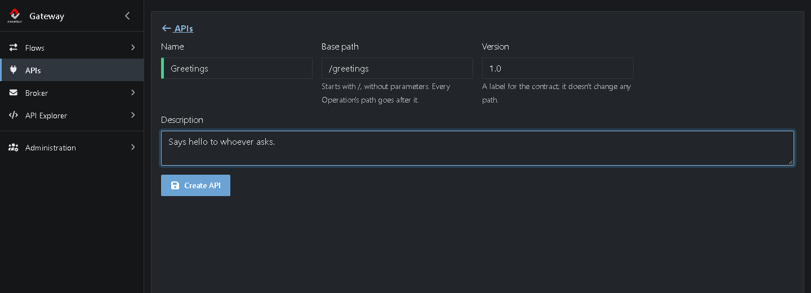
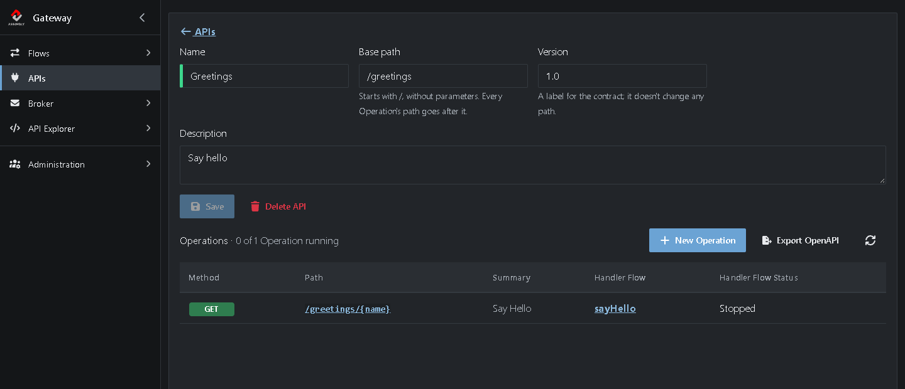
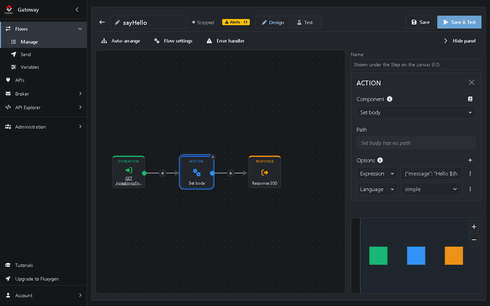
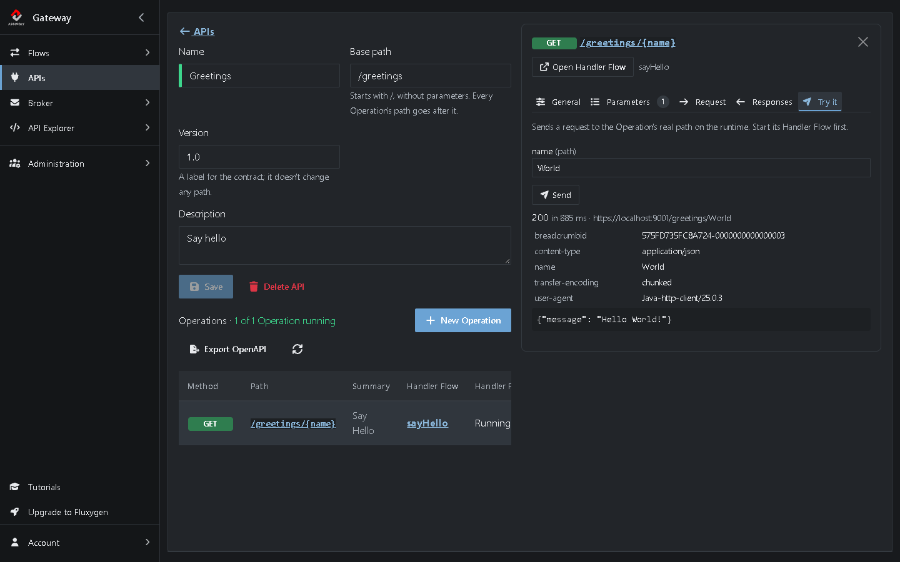

# Tutorial 4: Creating a REST API

<!-- tutorial: {"id":"tutorial4","wiki":"tutorial6-creating-a-rest-api","title":"Tutorial 4: Creating a REST API","minutes":10,"track":"Connect systems"} -->

**What you'll learn**

- Create a REST API that others can call
- Add an Operation and answer it with a Flow
- Call your API

It takes about 10 minutes.

<!-- web-only -->

> You can also follow this tutorial inside the Gateway: click **Tutorials** in the menu. It shows each step next to the screen it's about and ticks it off once you've done it.

## Step 1: Create the API

<!-- step: {"check":"apiExists:Greetings"} -->

You create an API that says hello to whoever calls it.

1. Click **APIs** in the menu on the left. <!-- show: .app-sidebar__link[href="/rest-apis"] -->
2. Click **Add**. <!-- show: a[href="/rest-apis/new"] @ /rest-apis -->
3. Fill in the form:
   - **Name:** `Greetings` <!-- show: #api-name @ /rest-apis/new -->
   - **Base path:** `/greetings` <!-- show: #api-base-path @ /rest-apis/new -->
   - **Description:** `Says hello to whoever asks.`
4. Click **Add API**. <!-- show: [data-tour="api-save"] @ /rest-apis/new -->



> **What are APIs, Operations and Handler Flows?**
>
> - An **API** groups Operations under one base path, such as `/greetings`.
> - An **Operation** is one method and path that clients can call, such as `GET /greetings/{name}`.
> - A **Handler Flow** answers an Operation. The Gateway creates it when you add the Operation.
>
> Together they make an [OpenAPI](https://www.openapis.org/) contract. In [Tutorial 3](https://github.com/assimbly/gateway/wiki/tutorial6-calling-a-rest-api) the Gateway called someone else's API; now others call yours.

## Step 2: Add an Operation

<!-- step: {"check":"flowExists:sayHello"} -->

1. Click **Add Operation**. <!-- show: [data-tour="api-new-operation"] @ api:Greetings --> A panel opens on the right.
2. Keep **Method** on `GET`.
3. In **Path**, type `{name}` after the `/`, so it reads `/{name}`. <!-- show: #operation-path -->
4. Set **operationId** to `sayHello` <!-- show: #operation-id --> and **Summary** to `Say hello`.
5. Click **Add Operation**. <!-- show: [data-tour="operation-save"] -->

The Operation appears in the list, with its Handler Flow _sayHello_.



> **What is `{name}`?** A _path parameter_: whatever the caller puts in that part of the path. It appears under **Parameters** by itself.

## Step 3: Build the Handler Flow

<!-- step: {"check":"flowStatus:sayHello:started"} -->

1. Click **sayHello** in the **Handler Flow** column. <!-- show: [data-tour="operation-handler-flow"] @ api:Greetings -->

The Flow is already there: the **Operation** receives the request and the **Response** sends the answer. You add the answer in between.

2. Click the **+** on the line between the Operation and the Response. <!-- show: [aria-label="Insert a Step here"] @ flow:sayHello -->
3. Type `body` in the search box and choose **Set body**.
4. Under **Options**, next to **Expression**, type: <!-- show: .option-row -->

   ```
   {"message": "Hello, ${header.name}!"}
   ```

5. Click **Test** at the top of the editor, <!-- show: [data-cy="mode-toggle"] @ flow:sayHello --> then click **▶** (Start) in the **Test** panel. <!-- show: [data-tour="flow-status-controls"] @ flow:sayHello:test -->



> **What does `${header.name}` do?** The Gateway puts every path parameter in a header with the same name, and `${header.name}` reads it.

## Step 4: Call your API

<!-- step: {"check":"flowCompleted:sayHello"} -->

1. Click **APIs**, <!-- show: .app-sidebar__link[href="/rest-apis"] --> then **Greetings**. It says **1 of 1 Operation running**.
2. Click **GET** in the row of the Operation. <!-- show: [data-tour="operation-edit"] @ api:Greetings -->
3. Click the **Try it** tab, <!-- show: [data-cy="operation-tab-try"] --> type `Assimbly` next to **name** and click **Send**. <!-- show: [data-tour="api-try-send"] -->

The answer comes back with status `200`:

```json
{ "message": "Hello, Assimbly!" }
```



## Step 5: Export the API as an OpenAPI file

1. Click **Export OpenAPI** on the API page. <!-- show: #export-openapi @ api:Greetings -->
2. Choose **Export as YAML**.

You get `Greetings-openapi.yaml`: the contract to give to the people who call your API.

3. When you're done, stop _sayHello_: on **Flows → Manage**, click **■** in its row.

## Summary

| What                    | Where             | What it does                                                                                    |
| ----------------------- | ----------------- | ----------------------------------------------------------------------------------------------- |
| API _Greetings_         | **APIs → Add**    | Groups the Operations under the base path `/greetings`.                                         |
| Operation `GET /{name}` | **Add Operation** | Defines what clients can call, and creates the Handler Flow.                                    |
| Handler Flow _sayHello_ | Flow editor       | **Operation** receives the request, **Set body** writes the answer, **Response** sends it back. |

**Done!** Continue with [Tutorial 5: Manage the broker](https://github.com/assimbly/gateway/wiki/tutorial6-create-a-new-broker).
