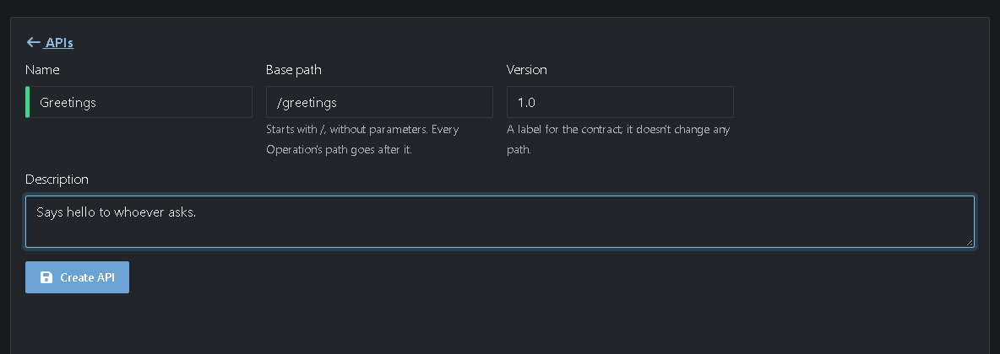
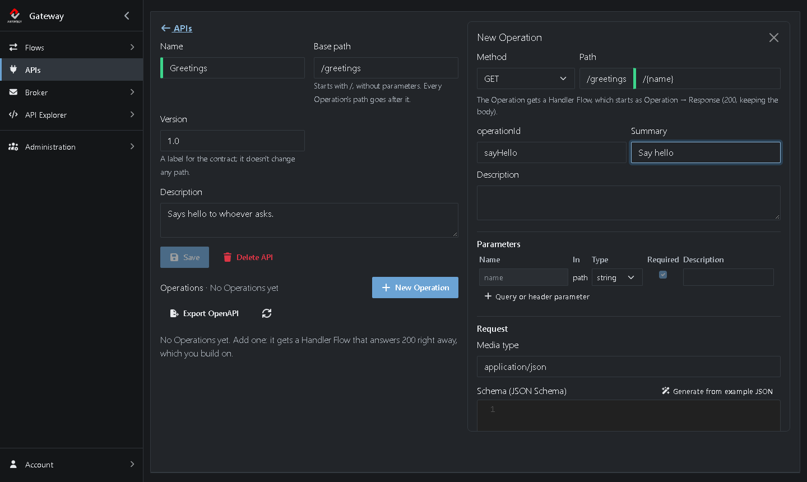
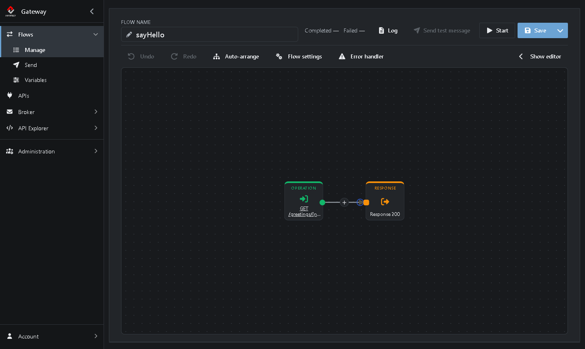
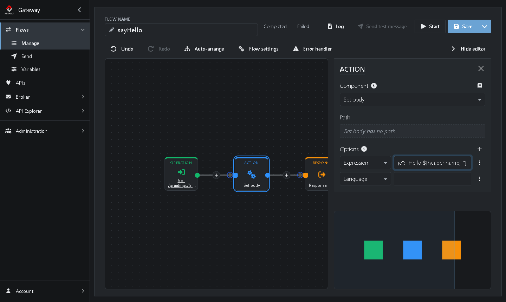
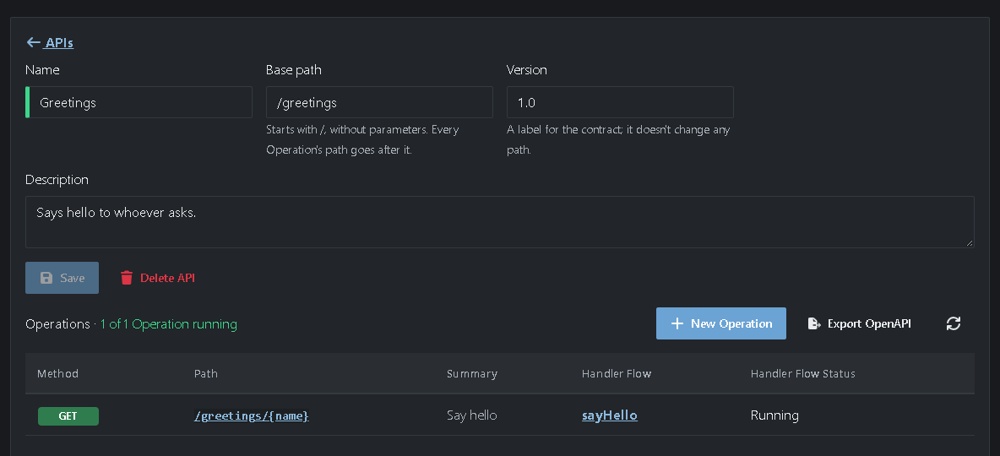

# Tutorial 4: Creating a REST API

<!-- tutorial: {"id":"tutorial4","title":"Tutorial 4: Creating a REST API","minutes":10} -->

In [Tutorial 3](https://github.com/assimbly/gateway/wiki/tutorial6-calling-a-rest-api) the Gateway called someone else's API. Now you turn things around: you create a REST API that others can call. It says hello to whoever calls it.

On the **APIs** page you design an API the way you would write an [OpenAPI](https://www.openapis.org/) contract:

* An **API** groups Operations under one base path, for example `/greetings`.
* An **Operation** is one method and path that clients can call, for example `GET /greetings/{name}`.
* A **Handler Flow** answers an Operation. The Gateway creates it when you add the Operation.

It takes about 10 minutes.

<!-- web-only -->
> You can also follow this tutorial inside the Gateway: click **Tutorials** in the menu. It shows each step next to the screen it's about and ticks it off once you've done it.

## Step 1: Create the API

<!-- step: {"check":"apiExists:Greetings"} -->

1. Click **APIs** in the menu on the left. <!-- show: .app-sidebar__link[href="/rest-apis"] -->
2. Click **Add**. <!-- show: a[href="/rest-apis/new"] -->
3. Fill in the form:
   * **Name:** `Greetings` <!-- show: #api-name -->
   * **Base path:** `/greetings` <!-- show: #api-base-path -->
   * **Version:** keep `1.0`
   * **Description:** `Says hello to whoever asks.`



4. Click **Create API**. <!-- show: [data-tour="api-save"] -->

## Step 2: Add an Operation

<!-- step: {"check":"flowExists:sayHello"} -->

1. Click **New Operation**. <!-- show: [data-tour="api-new-operation"] --> A panel opens on the right.
2. Keep **Method** on `GET`.
3. Type `{name}` after the `/` in **Path**, so it reads `/{name}`. <!-- show: #operation-path --> The part between curly braces is a *path parameter*: it appears under **Parameters** by itself.
4. Set **operationId** to `sayHello` <!-- show: #operation-id --> and **Summary** to `Say hello`.



5. Click **Add Operation**. <!-- show: [data-tour="operation-save"] -->

The Operation appears in the list with its Handler Flow, *sayHello*:


## Step 3: Build the Handler Flow

<!-- step: {"check":"flowStatus:sayHello:started"} -->

1. Click **sayHello** in the **Handler Flow** column. <!-- show: [data-tour="operation-handler-flow"] -->

The Gateway already built the Flow: the **Operation** receives the request and the **Response** sends the answer, with HTTP status 200. Right now the answer is empty. Add an Action that writes it:



2. Click the **+** on the line between the Operation and the Response. <!-- show: [aria-label="Insert a Step here"] -->
3. Type `body` in the search box and choose **Set body**.
4. Under **Options**, next to **Expression**, type: <!-- show: .option-row -->

   ```
   {"message": "Hello ${header.name}!"}
   ```



5. Click **Save**, <!-- show: [data-tour="flow-save"] --> then **Start**. <!-- show: [data-tour="flow-start"] -->

> **What does `${header.name}` do?** The Gateway puts every path parameter in a header with the same name, and `${header.name}` reads it. It's Camel's [Simple language](https://camel.apache.org/components/latest/languages/simple-language.html), which Set body uses by default, so leave **Language** empty.

## Step 4: Call your API

<!-- step: {"check":"flowCompleted:sayHello"} -->

1. Click **APIs**, <!-- show: .app-sidebar__link[href="/rest-apis"] --> then **Greetings**. It now says **1 of 1 Operation running**.



2. Click the path `/greetings/{name}`. <!-- show: [data-tour="operation-url"] --> Your API opens in a new tab of the browser.
3. The browser warns that the connection isn't private: the Gateway on your own machine uses its own certificate. Click **Advanced** and continue to `localhost`.

You see:

```json
{"message": "Hello {name}!"}
```

4. In the address bar, replace `{name}` with your own name, for example `World`, and press Enter:

```json
{"message": "Hello World!"}
```

## Step 5: Export the API as an OpenAPI file

Give the people who will call your API its contract:

1. Back in the Gateway, click **Export OpenAPI** on the API page. <!-- show: #export-openapi -->
2. Choose **Export as YAML**.

You get `Greetings-openapi.yaml`, which starts like this:

```yaml
openapi: 3.0.3
info:
  title: Greetings
  version: "1.0"
  description: Says hello to whoever asks.
servers:
- url: https://localhost:9001/greetings
paths:
  /{name}:
    get:
      operationId: sayHello
      summary: Say hello
```

Tools such as Postman, Insomnia or Swagger UI can import this file. It also works the other way around: **Import** on the **APIs** page creates an API from an OpenAPI file.

When you're done, stop *sayHello* with **Stop** in its editor.

## Summary

| What | Where | What it does |
|------|-------|--------------|
| API *Greetings* | **APIs → Add** | Groups the Operations under the base path `/greetings`. |
| Operation `GET /{name}` | **New Operation** | Defines what clients can call, and creates the Handler Flow. |
| Handler Flow *sayHello* | Flow editor | **Operation** receives the request, **Set body** writes the answer, **Response** sends it back. |

**Done!** Continue with [Tutorial 5: Manage the broker](https://github.com/assimbly/gateway/wiki/tutorial6-manage-the-broker).
