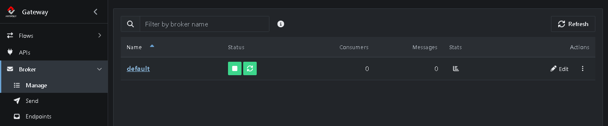
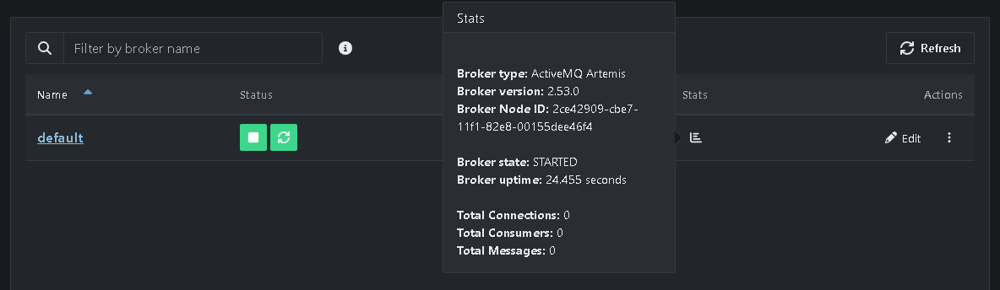
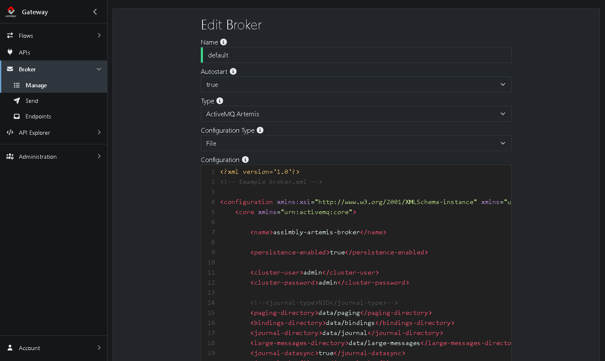
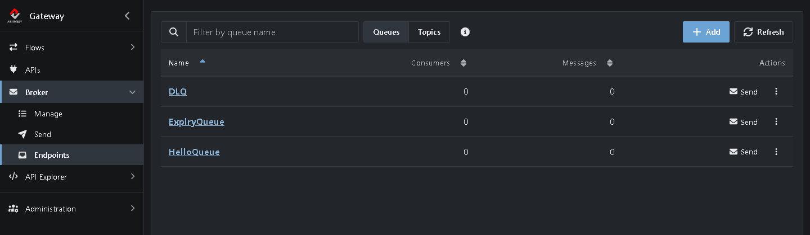
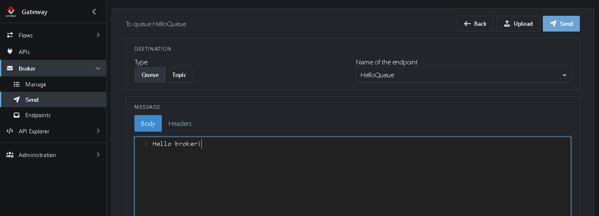
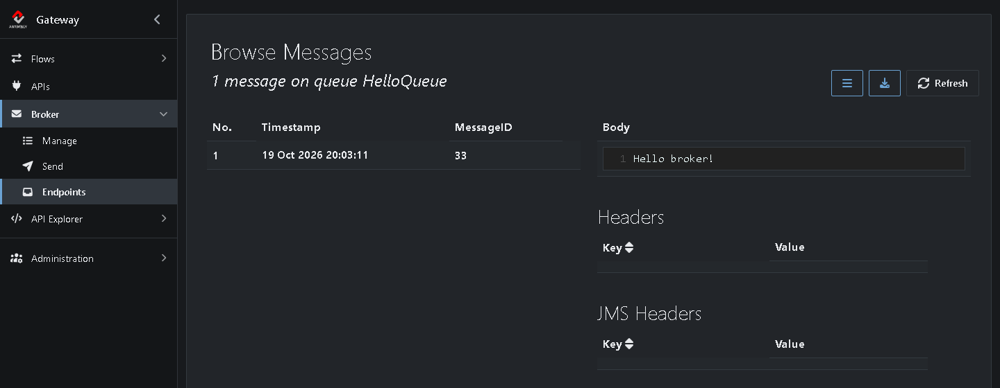

# Tutorial 5: Manage the broker

<!-- tutorial: {"id":"tutorial5","title":"Tutorial 5: Manage the broker","minutes":10} -->

The Gateway has a message broker built in. Get to know it: check that it runs, stop and start it, look at its configuration, add a queue, send a message to it and read the message back.

A **broker** is a message server. Instead of sending a message straight to another system, you put it on the broker, and the broker keeps it until someone picks it up. The sender and the receiver don't need to be online at the same time.

* A **queue** is a named place on the broker where messages wait. Each message is picked up by one receiver.
* A **topic** is like a queue, but every subscriber gets its own copy of each message.
* The Gateway calls queues and topics **Endpoints**.

You stop the broker for a moment, so use a Gateway you're trying out, not one that handles real messages.

It takes about 10 minutes.

<!-- web-only -->
> You can also follow this tutorial inside the Gateway: click **Tutorials** in the menu. It shows each step next to the screen it's about and ticks it off once you've done it.

## Step 1: Look at the broker

<!-- step: {"check":"route:/broker"} -->

Go to **Broker → Manage**. The Gateway created the broker *default* when it first started: an [ActiveMQ Artemis](https://activemq.apache.org/components/artemis/) broker that starts with the Gateway.

* The green buttons under **Status** show that it runs. <!-- show: [aria-label="Stop"] -->
* **Consumers** is the number of receivers connected, such as running Flows that read from a queue. **Messages** is the number of messages waiting, over all queues.
* Click **Stats** for details such as the version, the uptime and the connections. <!-- show: [aria-label="Stats"] -->

## Step 2: Stop and start the broker

<!-- step: {"check":"brokerStatus:stopped"} -->

1. Click **Stop** (the square). <!-- show: [aria-label="Stop"] -->

   While the broker is stopped, no one can put messages on it or take them off: Flows that use a queue fail until it's back.

2. Click **Start** (the triangle). <!-- show: [aria-label="Start"] -->

After a few seconds the green buttons are back. Messages that were waiting are still there: the broker keeps them on disk.

> **Restart** (the circular arrows) stops and starts the broker in one go. You need it after you change the broker's configuration.

## Step 3: Look at the broker file

1. Click **Edit** in the row of *default*. <!-- show: [aria-label="Edit"] -->

* **Autostart** `true`: the broker starts with the Gateway.
* **Type** `ActiveMQ Artemis`. The other option is `ActiveMQ Classic`.
* **Configuration Type** `File`: the broker uses the file below, `broker.xml`. <!-- show: #field_configuration_type --> It's in `~/.assimbly/broker/`.

In the file, `<acceptors>` sets the ports clients connect to, such as `61616` for JMS, and `<addresses>` the queues that always exist, such as `DLQ` (the dead letter queue).

To change the broker, you would edit the file, click **Save**, then **Restart** on **Broker → Manage**.

2. For now, click **Cancel**. <!-- show: #cancel-save -->

## Step 4: Create a queue

<!-- step: {"check":"queueExists:HelloQueue"} -->

1. Go to **Broker → Endpoints**. The **Queues** tab lists the queues on the broker.
2. Click **Add**. <!-- show: [aria-label="Add"] -->
3. Set **Name** to `HelloQueue`. <!-- show: #field_name -->

4. Click **Save**. <!-- show: #save-entity -->

*HelloQueue* appears in the list, with 0 messages:

## Step 5: Send a message

<!-- step: {"check":"queueMessages:HelloQueue"} -->

1. Click **Send** in the row of *HelloQueue*. <!-- show: tr[data-endpoint-name="HelloQueue"] [aria-label="Send"] --> The **Send** page opens with *HelloQueue* as destination.
2. Under **Body**, type `Hello broker!`. <!-- show: .body-codemirror -->

3. Click **Send** at the top right. <!-- show: [title="Send (Ctrl+Enter)"] -->

A notification confirms: *Message sent to queue HelloQueue*.

## Step 6: Browse the message

<!-- step: {"check":"route:endpointName=HelloQueue"} -->

1. Go to **Broker → Endpoints**. *HelloQueue* now has 1 message.
2. Click **HelloQueue**. <!-- show: tr[data-endpoint-name="HelloQueue"] td a -->

**Browse Messages** lists the messages on the queue. On the right you see the body and the headers of the selected one:

Browsing only *looks*: the messages stay on the queue until a receiver picks them up. In [Tutorial 6](https://github.com/assimbly/gateway/wiki/tutorial6-message-queueing) a Flow does that.

> **Clean up?** On **Broker → Endpoints**, click **⋮** in the row of *HelloQueue* and choose **Delete**. **Clear** keeps the queue but removes its messages.

## Summary

| What | Where | What it does |
|------|-------|--------------|
| Broker | **Broker → Manage** | The message server. Start, stop, restart and check it here. |
| Broker file | **Edit** on **Broker → Manage** | The broker's configuration (`broker.xml`). Restart the broker after you change it. |
| Queue | **Broker → Endpoints** | A named place where messages wait. Add, browse, clear or delete it here. |
| Send | **Broker → Send**, or **Send** in a queue's row | Puts a test message on a queue or topic. |
| Browse | Click a queue on **Broker → Endpoints** | Shows the waiting messages, without removing them. |

**Done!** Continue with [Tutorial 6: Message Queueing](https://github.com/assimbly/gateway/wiki/tutorial6-message-queueing).
