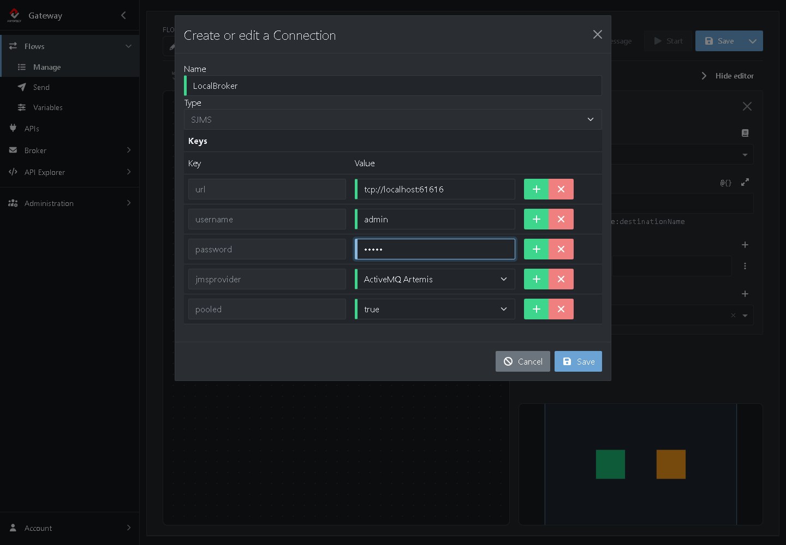
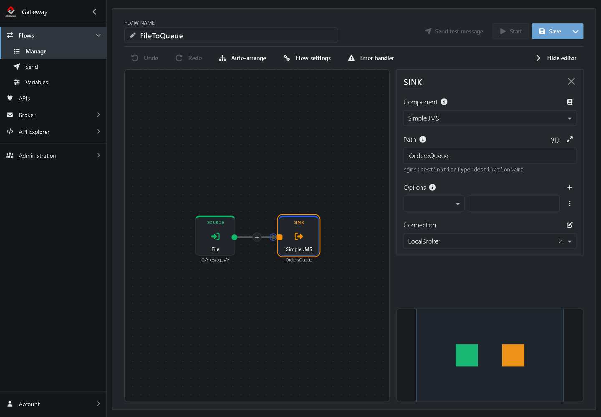
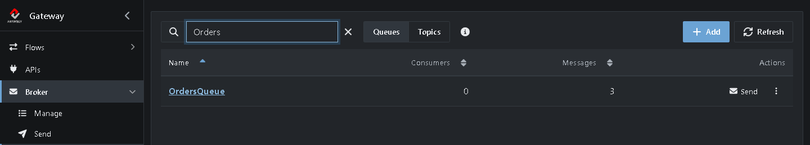
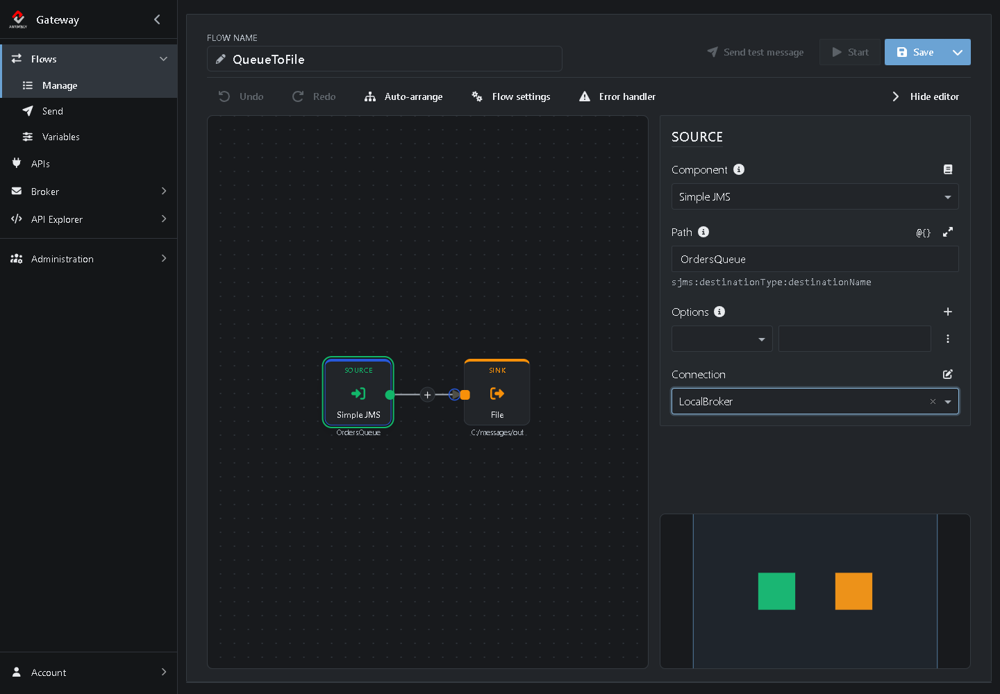

# Tutorial 6: Message Queueing

<!-- tutorial: {"id":"tutorial6","title":"Tutorial 6: Message Queueing","minutes":15,"fixtures":{"TestFlow":"TestFlow.xml"}} -->

Put a queue between two Flows. The first Flow puts files on a queue, the second takes them off and writes them to a folder. You'll see why queues are useful: when the receiving Flow isn't running, messages wait on the queue until it is.

**FileToQueue:** **File (Source)** → **Simple JMS (Sink)**, which puts each file on *OrdersQueue*

**QueueToFile:** **Simple JMS (Source)** → **File (Sink)**, which takes each message off *OrdersQueue*

The two Flows don't know about each other, only the queue. In real integrations the two sides are often different systems, such as a web shop and an ERP system. A queue between them:

* **Buffers.** When the receiver is down or slow, messages wait instead of getting lost.
* **Decouples.** You can stop, change or replace one Flow without touching the other.
* **Spreads the load.** Several Flows can take messages off the same queue.

It takes about 15 minutes.

<!-- web-only -->
> You can also follow this tutorial inside the Gateway: click **Tutorials** in the menu. It shows each step next to the screen it's about and ticks it off once you've done it.

## Before you start

<!-- step: {"check":"flowExists:TestFlow"} -->

* You need *TestFlow* from [Tutorial 1](https://github.com/assimbly/gateway/wiki/tutorial6-debugging-a-flow): it moves files from `C:/messages/in` to `C:/messages/out`. No *TestFlow*? Click **Add TestFlow** in the Tutorials panel, or import [TestFlow.xml](https://github.com/assimbly/documentation/blob/master/tutorials/v6/tutorial6/TestFlow.xml) with **Import** on **Flows → Manage**.
* Make sure *TestFlow* is stopped on **Flows → Manage**. Otherwise it picks up the files before the new Flows can.
* You need a running broker, such as the *default* broker that comes with the Gateway. [Tutorial 5](https://github.com/assimbly/gateway/wiki/tutorial6-create-a-new-broker) shows where to check it.

> On Linux or macOS, use `/home/<you>/messages/...` wherever this tutorial says `C:/messages/...`. Added *TestFlow* from the file? Change the paths of its Source and Sink after you've cloned it.

## Step 1: Clone TestFlow

<!-- step: {"check":"route:mode=clone"} -->

1. Go to **Flows → Manage**.
2. In the row of *TestFlow*, click **⋮** (*More actions*) and choose **Clone**. <!-- show: tr[data-flow-name="TestFlow"] [aria-label="More actions"] -->
3. Next to **Flow name**, type `FileToQueue`. <!-- show: #field_flowName -->

## Step 2: Put the files on a queue

1. Click the **Sink** on the canvas. <!-- show: .flow-step-sink --> Its settings open on the right. (Don't see them? Click **Show editor**.)
2. Click **Component**, type `sjms` and choose **Simple JMS**. <!-- show: [formcontrolname="componentType"] -->
3. Set **Path** to `OrdersQueue`, the name of the queue. <!-- show: [formcontrolname="uri"] -->

You don't have to create the queue first: the broker creates it the first time a Flow uses it.

## Step 3: Connect to the broker

<!-- step: {"check":"connectionExists:LocalBroker"} -->

A JMS component needs to know which broker to talk to. That's what a **Connection** is for, and the Sink now has a **Connection** field.

1. Click the **+** next to **Connection**. <!-- show: [data-tour="step-new-connection"] --> The window *Create or edit a Connection* opens.
2. Fill it in:
   * **Name:** `LocalBroker`
   * **url:** `tcp://localhost:61616`, the address of the broker that runs in the Gateway
   * **username:** `admin`
   * **password:** `admin`
   * **jmsprovider:** `ActiveMQ Artemis`
   * **pooled:** `true`, so the connection reuses open connections, which is faster



3. Click **Save**.

*LocalBroker* is now selected under **Connection**:



> The username and password are those of the broker. If you changed them in the broker's configuration, use your own.

## Step 4: Start it and send files

<!-- step: {"check":"queueMessages:OrdersQueue"} -->

1. Click **Save**, <!-- show: [data-tour="flow-save"] --> then **Start**. <!-- show: [data-tour="flow-start"] -->
2. Put three files in the `in` folder:

   **Windows (PowerShell)**

   ```powershell
   1..3 | ForEach-Object { "Order $_" | Out-File C:\messages\in\order-$_.txt }
   ```

   **Linux / macOS**

   ```bash
   for i in 1 2 3; do echo "Order $i" > ~/messages/in/order-$i.txt; done
   ```

*FileToQueue* picks up the files and puts them on the queue: **Completed** goes to 3. <!-- show: [data-tour="flow-completed"] --> Nobody takes them off yet, because the Flow that does isn't there yet.

## Step 5: See the messages wait

<!-- step: {"check":"route:endpointName=OrdersQueue"} -->

1. Go to **Broker → Endpoints** and type `Orders` in the filter box.



*OrdersQueue* has 3 messages and 0 consumers: no one reads from it.

2. Click **OrdersQueue** to browse the messages, like you did in Tutorial 5. <!-- show: tr[data-endpoint-name="OrdersQueue"] td a -->

The messages stay on the queue until a Flow takes them off.

## Step 6: Build the Flow that takes messages off the queue

1. Go to **Flows → Manage** and clone *TestFlow* once more. <!-- show: tr[data-flow-name="TestFlow"] [aria-label="More actions"] -->
2. Next to **Flow name**, type `QueueToFile`. <!-- show: #field_flowName -->
3. Click the **Source** on the canvas. <!-- show: .flow-step-source -->
4. Click **Component**, type `sjms` and choose **Simple JMS**. <!-- show: [formcontrolname="componentType"] -->
5. Set **Path** to `OrdersQueue`. <!-- show: [formcontrolname="uri"] -->
6. Under **Connection**, choose `LocalBroker`. <!-- show: [formcontrolname="connection"] --> You create a Connection once; after that, every Flow can use it.



The Sink of this Flow is still the File component of *TestFlow*: it writes to `C:/messages/out`.

## Step 7: Start it and watch the queue empty

<!-- step: {"check":"flowCompleted:QueueToFile"} -->

1. Click **Save**, <!-- show: [data-tour="flow-save"] --> then **Start**. <!-- show: [data-tour="flow-start"] -->

*QueueToFile* takes the waiting messages off the queue right away: **Completed** goes to 3. <!-- show: [data-tour="flow-completed"] --> In the `out` folder you now find `order-1.txt`, `order-2.txt` and `order-3.txt`, with their original names.

2. Check **Broker → Endpoints** once more. *OrdersQueue* is empty and has 1 consumer: the running *QueueToFile*.


With both Flows running, every new file in the `in` folder travels through the queue to the `out` folder right away. Try it! Or stop *QueueToFile*, drop a few files and watch them wait on the queue until you start it again.

When you're done, stop both Flows on **Flows → Manage**.

## Summary

| What | Where | What it does |
|------|-------|--------------|
| **Simple JMS** Sink | *FileToQueue* | Puts every message on *OrdersQueue*. |
| **Simple JMS** Source | *QueueToFile* | Takes every message off *OrdersQueue*. |
| Connection *LocalBroker* | **Connection** field of a JMS Step | Tells the JMS component how to reach the broker. Create it once, use it in every Flow. |
| *OrdersQueue* | **Broker → Endpoints** | Holds the messages until a Flow takes them off. |

**Done!** You built your first Flows with message queueing. Continue with [Tutorial 7: Create a simple route](https://github.com/assimbly/gateway/wiki/tutorial6-simple-route).
