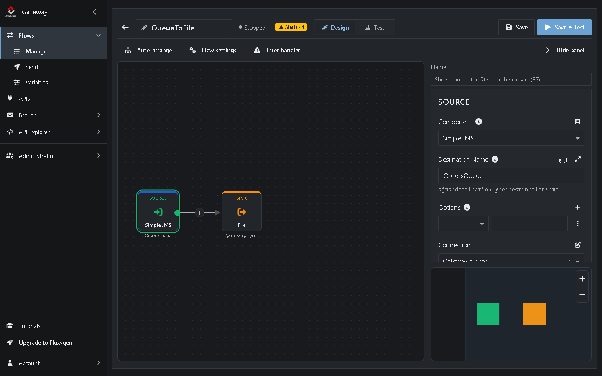
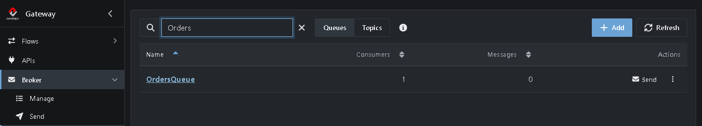

# Tutorial 6: Message Queueing

<!-- tutorial: {"id":"tutorial6","wiki":"tutorial6-message-queueing","title":"Tutorial 6: Message Queueing","minutes":15,"track":"Messaging","fixtures":{"TestFlow":"TestFlow.xml"}} -->

**What you'll learn**

- Put messages on a queue from a Flow
- Take them off with another Flow
- See messages wait while the receiver is stopped

**FileToQueue:** **File** → **Simple JMS**, onto _OrdersQueue_

**QueueToFile:** **Simple JMS** → **File**, off _OrdersQueue_

It takes about 15 minutes.

<!-- web-only -->

> You can also follow this tutorial inside the Gateway: click **Tutorials** in the menu. It shows each step next to the screen it's about and ticks it off once you've done it.

## Before you start

- _TestFlow_ from [Tutorial 1](https://github.com/assimbly/gateway/wiki/tutorial6-your-first-flow). No _TestFlow_? Click **Add TestFlow** in the Tutorials panel, or import [TestFlow.xml](https://github.com/assimbly/documentation/blob/master/tutorials/v6/tutorial6/TestFlow.xml) on **Flows → Manage**.
- A running broker, such as the _default_ one: see [Tutorial 5](https://github.com/assimbly/gateway/wiki/tutorial6-create-a-new-broker)

## Step 1: Clone TestFlow

<!-- step: {"check":"route:mode=clone"} -->

You put a queue between two Flows. The first puts files on it, the second takes them off.

1. Go to **Flows → Manage**.
2. In the row of _TestFlow_, click **⋮** (_More actions_) and choose **Clone**. <!-- show: tr[data-flow-name="TestFlow"] [aria-label="More actions"] @ / -->
3. At the top left, where it says _Flow name_, type `FileToQueue`. <!-- show: #field_flowName -->
4. Click the **Source** on the canvas <!-- show: .flow-step-source --> and change **Directory Name** to `@{messages}/orders`. <!-- show: [formcontrolname="uri"] -->

> **Why another folder?** So _TestFlow_ doesn't pick up the files of _FileToQueue_, even when it runs.

## Step 2: Put the files on a queue

1. Click the **Sink** on the canvas. <!-- show: .flow-step-sink -->
2. Click **Component**, type `sjms` and choose **Simple JMS**. <!-- show: [formcontrolname="componentType"] -->
3. Set **Destination Name** to `OrdersQueue`. <!-- show: [formcontrolname="uri"] -->
4. Check that **Connection** says _Gateway broker_. <!-- show: [formcontrolname="connection"] -->

> **Do I create the queue first?** No. The broker creates it the first time a Flow uses it.

> **What is the Connection for?** A JMS component needs to know which broker to talk to. The Gateway comes with a Connection to its built-in broker, _Gateway broker_, and picks it for you when it's the only one.

## Step 3: Start it and send files

<!-- step: {"check":"queueMessages:OrdersQueue"} -->

1. Click **Test** at the top of the editor. <!-- show: [data-cy="mode-toggle"] --> The Flow is saved automatically and the **Test** panel opens beside the Visual flow. <!-- show: [data-cy="test-tester"] @ flow:FileToQueue:test -->
2. Click **▶** (Start) in the **Test** panel. <!-- show: [data-tour="flow-status-controls"] @ flow:FileToQueue:test -->
3. Under **In**, type `Order 1` in **Body** and click **Test**. <!-- show: [data-cy="test-run"] @ flow:FileToQueue:test -->
4. Do the same with `Order 2` and `Order 3`, with **Test again**.

Click the **Visual flow** tab: <!-- show: [data-cy="test-view-flow"] @ flow:FileToQueue:test --> the Sink shows **3**: three messages are on the queue.

## Step 4: See the messages wait

<!-- step: {"check":"route:endpointName=OrdersQueue"} -->

1. Go to **Broker → Queues & Topics** and type `Orders` in the filter box.

_OrdersQueue_ has 3 messages and 0 consumers: no one reads from it.

2. Click **OrdersQueue** to browse the messages. <!-- show: tr[data-endpoint-name="OrdersQueue"] td a @ /queue -->

## Step 5: Build the Flow that takes messages off the queue

1. Go to **Flows → Manage** and clone _TestFlow_ once more. <!-- show: tr[data-flow-name="TestFlow"] [aria-label="More actions"] @ / -->
2. At the top left, where it says _Flow name_, type `QueueToFile`. <!-- show: #field_flowName -->
3. Click the **Source** on the canvas. <!-- show: .flow-step-source -->
4. Click **Component**, type `sjms` and choose **Simple JMS**. <!-- show: [formcontrolname="componentType"] -->
5. Set **Destination Name** to `OrdersQueue`. <!-- show: [formcontrolname="uri"] -->
6. Check that **Connection** says _Gateway broker_. <!-- show: [formcontrolname="connection"] -->

> **And the Sink?** It's still the File component of _TestFlow_: it writes to `@{messages}/out`.

## Step 6: Start it and watch the queue empty

<!-- step: {"check":"flowCompleted:QueueToFile"} -->

1. Click **Test** at the top of the editor, <!-- show: [data-cy="mode-toggle"] --> then click **▶** (Start) in the **Test** panel. <!-- show: [data-tour="flow-status-controls"] @ flow:QueueToFile:test -->

The Steps on the canvas show **3**: _QueueToFile_ took the waiting messages off the queue. `@{messages}/out` now has three files, one per order.

2. Go to **Broker → Queues & Topics**. _OrdersQueue_ is empty and has 1 consumer: _QueueToFile_.

3. When you're done, stop both Flows on **Flows → Manage**.

## Summary

| What                        | Where                              | What it does                                                                                       |
| --------------------------- | ---------------------------------- | -------------------------------------------------------------------------------------------------- |
| **Simple JMS** Sink         | _FileToQueue_                      | Puts every message on _OrdersQueue_.                                                               |
| **Simple JMS** Source       | _QueueToFile_                      | Takes every message off _OrdersQueue_.                                                             |
| Connection _Gateway broker_ | **Connection** field of a JMS Step | Tells the JMS component how to reach the broker. The Gateway comes with it; every Flow can use it. |
| _OrdersQueue_               | **Broker → Queues & Topics**       | Holds the messages until a Flow takes them off.                                                    |

**Done!** You built your first Flows with message queueing. Know Camel? Continue with [Tutorial 7: Create a simple route](https://github.com/assimbly/gateway/wiki/tutorial6-simple-route).
