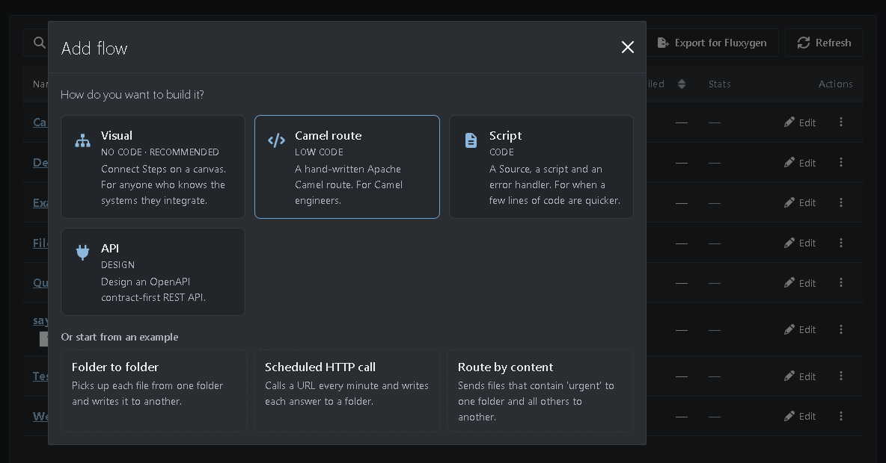
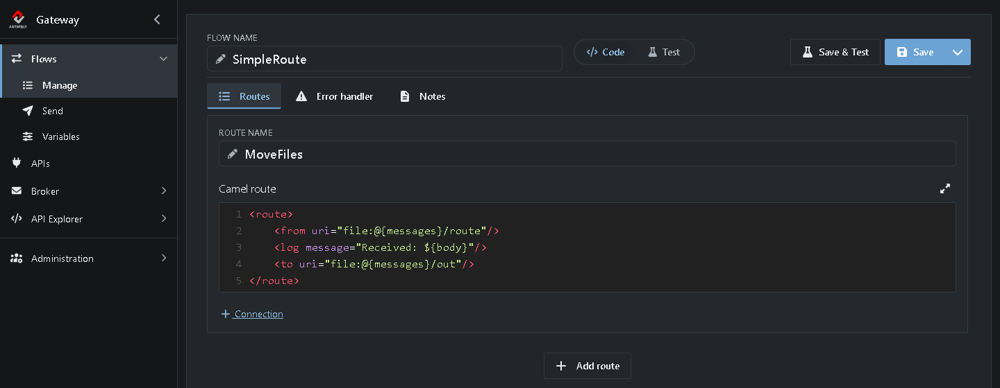
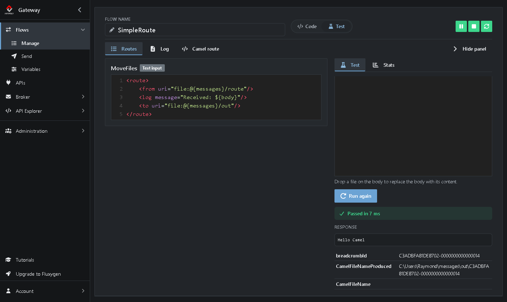

# Tutorial 7: Create a simple route

<!-- tutorial: {"id":"tutorial7","wiki":"tutorial6-simple-route","title":"Tutorial 7: Create a simple route","minutes":10,"track":"For Camel developers"} -->

**What you'll learn**

* Write a Camel route in XML
* Run it as a Flow
* Find its log message

It takes about 10 minutes.

<!-- web-only -->
> You can also follow this tutorial inside the Gateway: click **Tutorials** in the menu. It shows each step next to the screen it's about and ticks it off once you've done it.

## Before you start

* Camel knowledge helps, but isn't needed: the [Camel routes](https://camel.apache.org/manual/routes.html) page is a good start

## How it works

Under the hood, the Gateway runs every Flow as an [Apache Camel](https://camel.apache.org/) route. You can also write one yourself. The route in this tutorial moves files from one folder to another and logs the name of each file:

```xml
<route>
    <from uri="file:@{messages}/route"/>
    <log message="Received file ${header.CamelFileName}"/>
    <to uri="file:@{messages}/out"/>
</route>
```

* `<from>` picks up files from the `route` folder, like a Source.
* `<log>` writes a line to the log, with the name of the file in place of `${header.CamelFileName}`.
* `<to>` writes the file to the `out` folder, like a Sink.

`@{messages}` is the Variable for your messages folder (see **Flows → Variables**).

## Step 1: Create a Camel route Flow

<!-- step: {"check":"route:editor=route"} -->

1. Go to **Flows → Manage** and click **Add**. <!-- show: [aria-label="Add"] -->
2. Choose **Camel route** (marked *Low code*). <!-- show: a.flow-type-choice[href*="editor=route"] -->



The route editor opens. Instead of a canvas, it has a field to write the route in. It starts with a small example route, which sends `Hello world` once and logs it.

## Step 2: Write the route

<!-- step: {"check":"flowExists:SimpleRoute"} -->

1. Next to **Flow name**, type `SimpleRoute`. <!-- show: #field_flowName -->
2. Set **Route name** to `MoveFiles`. <!-- show: [formcontrolname="routeName"] -->
3. Replace the example in the **Route** field with this route: <!-- show: [data-tour="route-content"] -->

   ```xml
   <route>
       <from uri="file:@{messages}/route"/>
       <log message="Received file ${header.CamelFileName}"/>
       <to uri="file:@{messages}/out"/>
   </route>
   ```



4. Click **Save**. <!-- show: [data-tour="flow-save"] -->

> **Tips**
> * Click the **Edit route** icon above the field to write the route in a full-screen editor.
> * With **Add** you add more routes to the same Flow, for example routes that call each other. You do that in Tutorial 8.
> * Under **Error handler name** you can write a route that handles errors. Leave it empty to use the default error handling.

## Step 3: Run the route and send it a file

<!-- step: {"check":"flowCompleted:SimpleRoute"} -->

1. Click **Start**. <!-- show: [data-tour="flow-start"] -->
2. Go to **Flows → Send**. <!-- show: .app-sidebar__link[href="/flow/message-sender"] --> On this page you send a message to any endpoint.
3. Keep **Component** on `file` and type `@{messages}/route` as **Path**. Press Enter.
4. Under **Body**, paste this list of names: <!-- show: .body-codemirror -->

   ```xml
   <names>
       <name>
          <firstname>John</firstname>
          <lastname>Doe</lastname>
       </name>
       <name>
          <firstname>Michael</firstname>
          <lastname>Kay</lastname>
       </name>
       <name>
          <firstname>Jane</firstname>
          <lastname>Smith</lastname>
       </name>
   </names>
   ```

5. Click **Send**. <!-- show: [title="Send (Ctrl+Enter)"] -->

The Gateway writes the list as a file in the `route` folder. Your route picks it up and moves it to the `out` folder of your messages folder: `@{messages}/out`. Open *SimpleRoute* again: its **Completed** counter went up.



## Step 4: Find the log message

<!-- step: {"check":"flowLog:SimpleRoute:Received file"} -->

1. Open *SimpleRoute* on **Flows → Manage** and click **Log** in the editor header. <!-- show: [data-tour="flow-log"] -->
2. Type `Received file` in the filter box. <!-- show: #flowLogSearchText -->

There it is: `Received file ...`, written by the `<log>` line of your route, followed by the name of the file.

> **See it as Camel runs it.** Click **Camel route** in the editor header to see the route the runtime built, with `@{messages}` filled in. <!-- show: [data-tour="flow-camel-route"] --> It works for visual Flows too: open *TestFlow*, start it and click **Camel route** to see the Camel route behind the canvas, ready to copy or download.

When you're done, close the log and click **Stop**. <!-- show: [data-tour="flow-stop"] -->

## Visual Flow or Camel route?

| | Visual Flow | Camel route |
|---|---|---|
| **Build** | Click Steps together on a canvas | Write XML |
| **For** | Anyone who knows the systems they integrate | Camel engineers |
| **Strength** | Quick to build and easy to read | Everything Camel can do, such as splitting, filtering and routing on content |

You can mix them: some Flows visual, others as Camel routes, all running in the same Gateway.

**Done!** You wrote and ran your first Camel route. In the next tutorial you build a bigger route with queues and a split: [Tutorial 8: A route with queues and a split](https://github.com/assimbly/gateway/wiki/tutorial6-routes-with-split).
