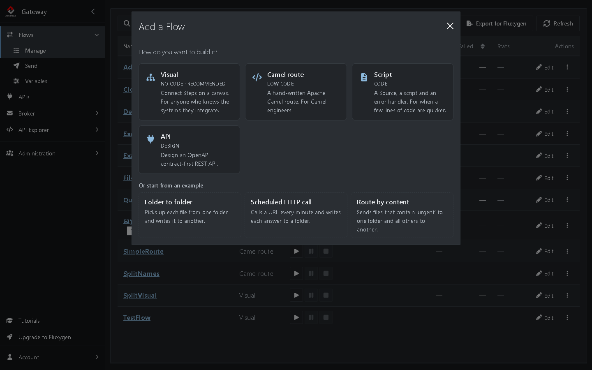
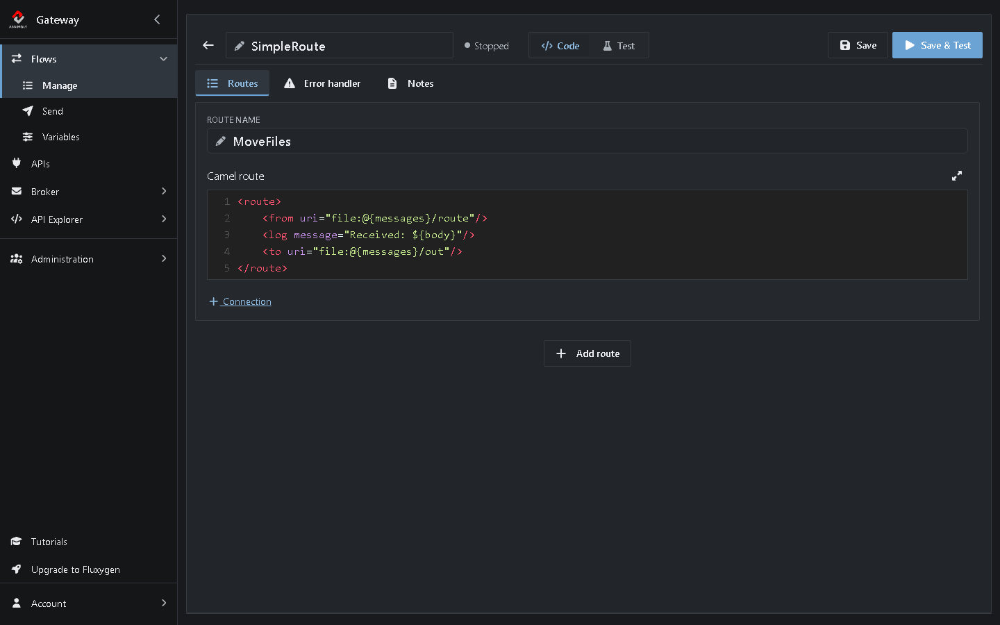
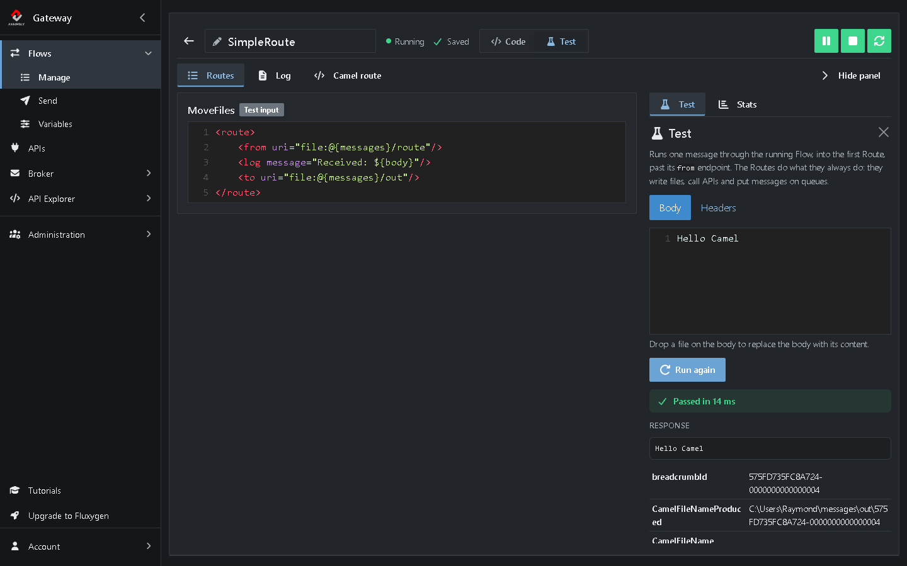

# Tutorial 7: Create a simple route

<!-- tutorial: {"id":"tutorial7","wiki":"tutorial6-simple-route","title":"Tutorial 7: Create a simple route","minutes":10,"track":"For Camel developers"} -->

**What you'll learn**

- Write a Camel route in XML
- Run it as a Flow
- Find its log message

It takes about 10 minutes.

<!-- web-only -->

> You can also follow this tutorial inside the Gateway: click **Tutorials** in the menu. It shows each step next to the screen it's about and ticks it off once you've done it.

## Before you start

- Camel knowledge helps, but isn't needed: the [Camel routes](https://camel.apache.org/manual/routes.html) page is a good start

## How it works

The Gateway runs every Flow as an [Apache Camel](https://camel.apache.org/) route. You can also write one yourself. You write this one: it moves files from one folder to another and logs what's in each file.

```xml
<route>
    <from uri="file:@{messages}/route"/>
    <log message="Received: ${body}"/>
    <to uri="file:@{messages}/out"/>
</route>
```

> **What does each line do?**
>
> - `<from>` picks up files from the `route` folder, like a Source.
> - `<log>` writes a line to the log, with the content of the message in place of `${body}`.
> - `<to>` writes the file to the `out` folder, like a Sink.
>
> `@{messages}` is the Variable for your messages folder (see **Flows → Variables**).

## Step 1: Create a Camel route Flow

<!-- step: {"check":"route:editor=route"} -->

1. Go to **Flows → Manage** and click **Add**. <!-- show: [aria-label="Add"] @ / -->
2. Choose **Camel route**. <!-- show: a.flow-type-choice[href*="editor=route"] -->

The route editor opens, with a field to write the route in instead of a canvas.



> **What's already in the field?** A small example route, which sends `Hello world` once and logs it. You replace it in the next step.

## Step 2: Write the route

1. At the top left, where it says _Flow name_, type `SimpleRoute`. <!-- show: #field_flowName -->
2. Set **Route name** to `MoveFiles`. <!-- show: [formcontrolname="routeName"] -->
3. Replace the example in the **Camel route** field with: <!-- show: [data-tour="route-content"] -->

   ```xml
   <route>
       <from uri="file:@{messages}/route"/>
       <log message="Received: ${body}"/>
       <to uri="file:@{messages}/out"/>
   </route>
   ```



## Step 3: Run the route and send it a message

<!-- step: {"check":"flowCompleted:SimpleRoute"} -->

1. Click **Test** at the top of the editor. <!-- show: [data-cy="mode-toggle"] @ flow:SimpleRoute --> The Flow is saved automatically and the **Test** panel opens beside the Routes. <!-- show: [data-cy="test-tester"] @ flow:SimpleRoute:test -->
2. Click **▶** (Start) in the **Test** panel. <!-- show: [data-tour="flow-status-controls"] @ flow:SimpleRoute:test -->
3. Under **In**, type `Hello, Assimbly!` in **Body** and click **Test**. <!-- show: [data-cy="test-run"] @ flow:SimpleRoute:test -->

The Tester shows **Passed** under **Out**. Your message is now a file in `@{messages}/out`.



## Step 4: Find the log message

<!-- step: {"check":"flowLog:SimpleRoute:Received"} -->

1. Click the **Log** tab. <!-- show: [data-cy="test-view-log"] @ flow:SimpleRoute:test -->
2. Type `Received` in the filter box. <!-- show: #flowLogSearchText -->

There it is: `Received: Hello, Assimbly!`, written by the `<log>` line of your route.

3. When you're done, click the **Routes** tab and click **■** (Stop) in the **Test** panel. <!-- show: [data-tour="flow-status-controls"] @ flow:SimpleRoute:test -->

> **Tip: see the route as Camel runs it** Click the **Camel route** tab <!-- show: [data-cy="test-view-route"] @ flow:SimpleRoute:test --> to see the route the runtime built, with `@{messages}` filled in.

**Done!** You wrote and ran your first Camel route. In the next tutorial you build a bigger route with queues and a split: [Tutorial 8: A route with queues and a split](https://github.com/assimbly/gateway/wiki/tutorial6-routes-with-split).
