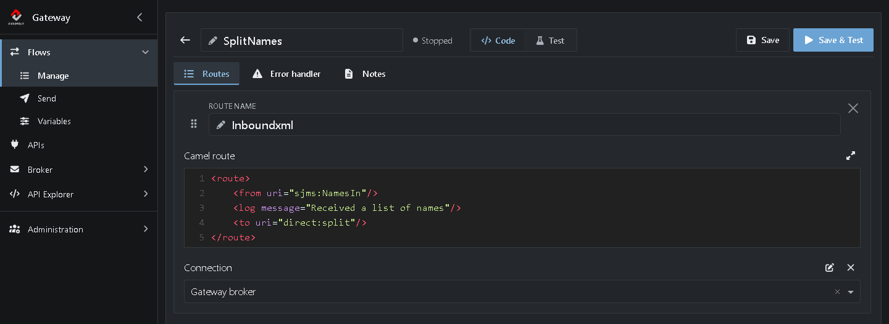
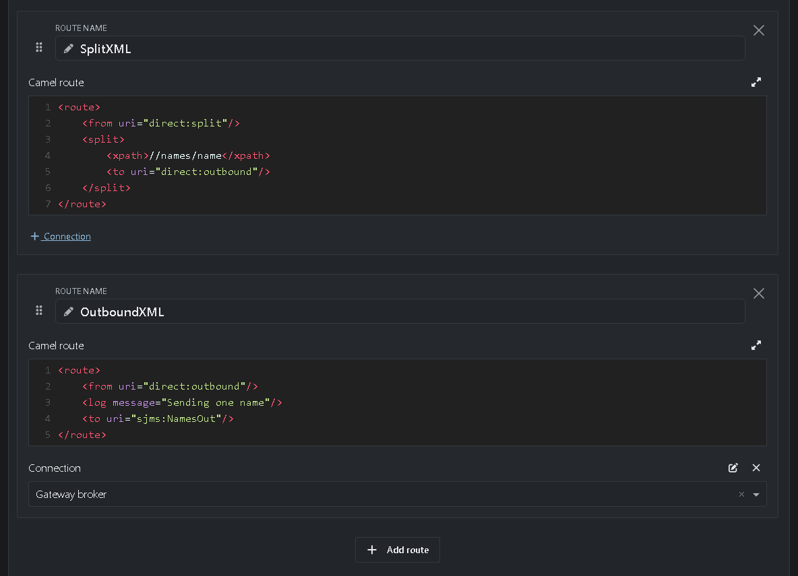
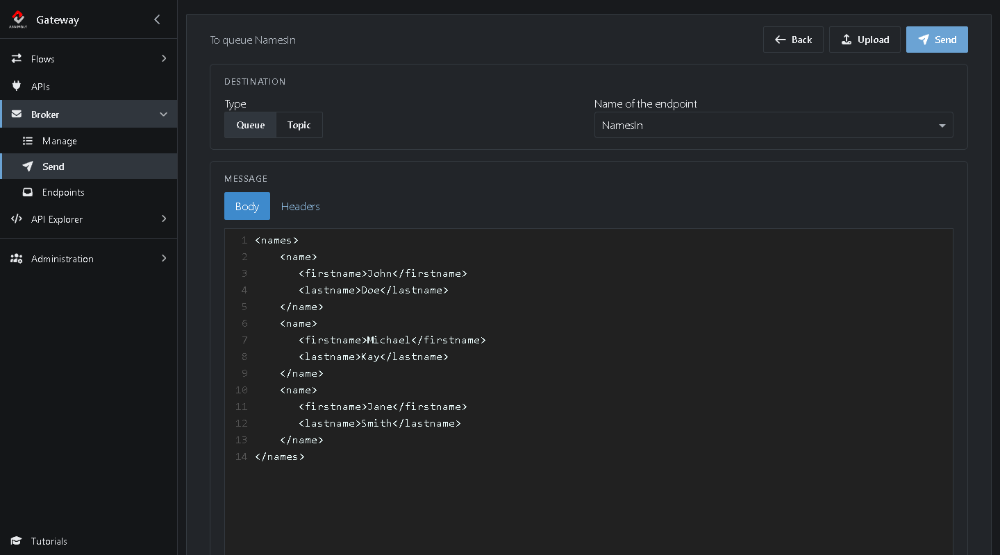
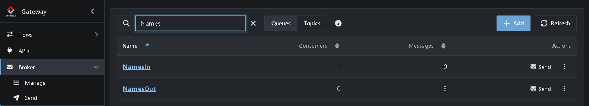
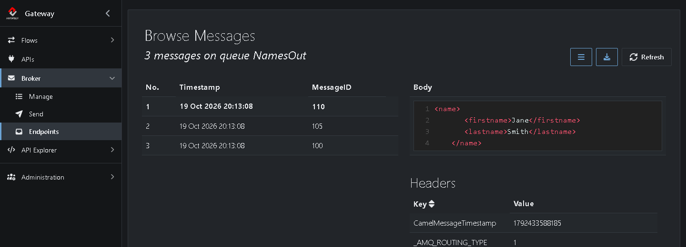

# Tutorial 8: A route with queues and a split

<!-- tutorial: {"id":"tutorial8","wiki":"tutorial6-routes-with-split","title":"Tutorial 8: A route with queues and a split","minutes":15,"track":"For Camel developers"} -->

**What you'll learn**

- Combine three routes in one Flow
- Read from and write to queues in a route
- Split a message into one per item

It takes about 15 minutes.

<!-- web-only -->

> You can also follow this tutorial inside the Gateway: click **Tutorials** in the menu. It shows each step next to the screen it's about and ticks it off once you've done it.

## Before you start

- [Tutorial 7](https://github.com/assimbly/gateway/wiki/tutorial6-simple-route), so you know the route editor
- The built-in broker running, with its Connection _Gateway broker_ (or your own Connection from [Tutorial 6](https://github.com/assimbly/gateway/wiki/tutorial6-message-queueing))

## How it works

You build the Flow _SplitNames_. It takes a list of names from a queue, splits it into one message per name, and puts each name on another queue. It has three routes:

**InboundXML:** queue _NamesIn_ → `direct:split`

**SplitXML:** `direct:split` → one message per `<name>` → `direct:outbound`

**OutboundXML:** `direct:outbound` → queue _NamesOut_

> **What is `direct:`?** An endpoint that connects routes within the same Gateway. The routes pass messages to each other with it.

> **Why three routes, not one?** Splitting it up keeps each route small, and you can reuse a route, such as _SplitXML_, from other routes.

## Step 1: Create the Flow

<!-- step: {"check":"route:editor=route"} -->

1. Go to **Flows → Manage**, click **Add** <!-- show: [aria-label="Add"] @ / --> and choose **Camel route**. <!-- show: a.flow-type-choice[href*="editor=route"] -->
2. At the top left, where it says _Flow name_, type `SplitNames`. <!-- show: #field_flowName -->
3. Set **Route name** to `InboundXML`. <!-- show: [formcontrolname="routeName"] -->

> **And the Error handler tab?** It holds a route for failed messages. Leave it empty: it's not one of the three routes.

## Step 2: Write the inbound route

1. Replace the example route in the **Camel route** field with: <!-- show: [data-tour="route-content"] -->

   ```xml
   <route>
       <from uri="sjms:NamesIn"/>
       <log message="Received a list of names"/>
       <to uri="direct:split"/>
   </route>
   ```

2. Click **+ Connection** under the route. <!-- show: [data-tour="step-add-connection"] -->
3. In **Connection**, choose _Gateway broker_. <!-- show: [formcontrolname="connection"] -->



> **What does this route do?** It takes each message from the queue _NamesIn_ and passes it on to `direct:split`.

> **Which endpoints use the Connection?** The JMS endpoints of the route: `sjms:`, `sjms2:`, `jms:` and `activemq:`. When an endpoint needs another Connection, name it in the URI yourself, with `connectionFactory=#<id>`. The **Edit connection** icon above the **Connection** field shows a Connection's id.

## Step 3: Write the split route

1. Click **Add route** under _InboundXML_. <!-- show: [data-tour="step-add"] -->
2. Set **Route name** to `SplitXML`.
3. Copy this route into its **Camel route** field:

   ```xml
   <route>
       <from uri="direct:split"/>
       <split>
           <xpath>//names/name</xpath>
           <to uri="direct:outbound"/>
       </split>
   </route>
   ```

> **How does the split work?** The [XPath](https://camel.apache.org/components/latest/languages/xpath-language.html) expression `//names/name` finds every `<name>` element in the message. Each one becomes a message of its own and goes to `direct:outbound`.

## Step 4: Write the outbound route

<!-- step: {"check":"flowStatus:SplitNames:started"} -->

1. Click **Add route** under _SplitXML_.
2. Set **Route name** to `OutboundXML`.
3. Copy this route into its **Camel route** field:

   ```xml
   <route>
       <from uri="direct:outbound"/>
       <log message="Sending one name"/>
       <to uri="sjms:NamesOut"/>
   </route>
   ```

4. Click **+ Connection** under _OutboundXML_ and choose _Gateway broker_.
5. Click **Test** at the top of the editor, <!-- show: [data-cy="mode-toggle"] --> then click **▶** (Start) in the **Test** panel. <!-- show: [data-tour="flow-status-controls"] @ flow:SplitNames:test -->



> **Do I create the queues?** No. The broker creates _NamesIn_ and _NamesOut_ the first time a route uses them.

## Step 5: Send a list of names

<!-- step: {"check":"queueMessages:NamesOut"} -->

1. Go to **Broker → Queues & Topics**. _NamesIn_ has 1 consumer: your _InboundXML_ route.
2. Click **Send** in the row of _NamesIn_. <!-- show: tr[data-endpoint-name="NamesIn"] [aria-label="Send"] @ /queue -->
3. Paste this XML into the **Body**: <!-- show: .body-codemirror -->

   ```xml
   <names>
       <name>
          <firstname>John</firstname>
          <lastname>Doe</lastname>
       </name>
       <name>
          <firstname>Michael</firstname>
          <lastname>Kay</lastname>
       </name>
       <name>
          <firstname>Jane</firstname>
          <lastname>Smith</lastname>
       </name>
   </names>
   ```

4. Click **Send**. <!-- show: [title="Send (Ctrl+Enter)"] -->



> **Tip: no NamesIn in the list?** The filter box keeps what you typed last time, such as `Orders` from Tutorial 6. Clear it with **×**.

## Step 6: See the result

<!-- step: {"check":"route:endpointName=NamesOut"} -->

1. Go to **Broker → Queues & Topics** and type `Names` in the filter box.

Your message to _NamesIn_ is gone, and _NamesOut_ has 3 more messages: one per name.



2. Click **NamesOut** to browse them. <!-- show: tr[data-endpoint-name="NamesOut"] td a @ /queue --> Each message holds one `<name>`.



3. When you're done, stop _SplitNames_: on **Flows → Manage**, click **■** in its row.

> **Clean up?** On **Broker → Queues & Topics**, click **⋮** → **Clear** in the row of _NamesOut_ to remove the test messages.

## Summary

| Route         | Reads from        | Does                     | Writes to                        |
| ------------- | ----------------- | ------------------------ | -------------------------------- |
| _InboundXML_  | queue _NamesIn_   | Logs a line              | `direct:split`                   |
| _SplitXML_    | `direct:split`    | Splits on `//names/name` | `direct:outbound`, once per name |
| _OutboundXML_ | `direct:outbound` | Logs a line              | queue _NamesOut_                 |

**Done!** You built a Flow of three routes with queues and a split. Continue with [Tutorial 9: Running scripts](https://github.com/assimbly/gateway/wiki/tutorial6-running-scripts).
