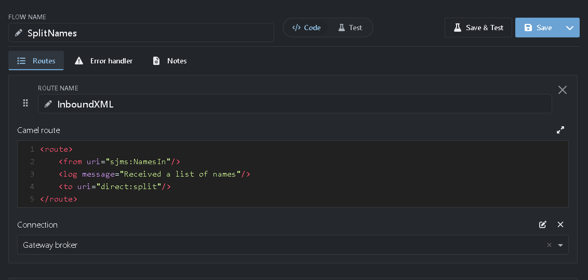
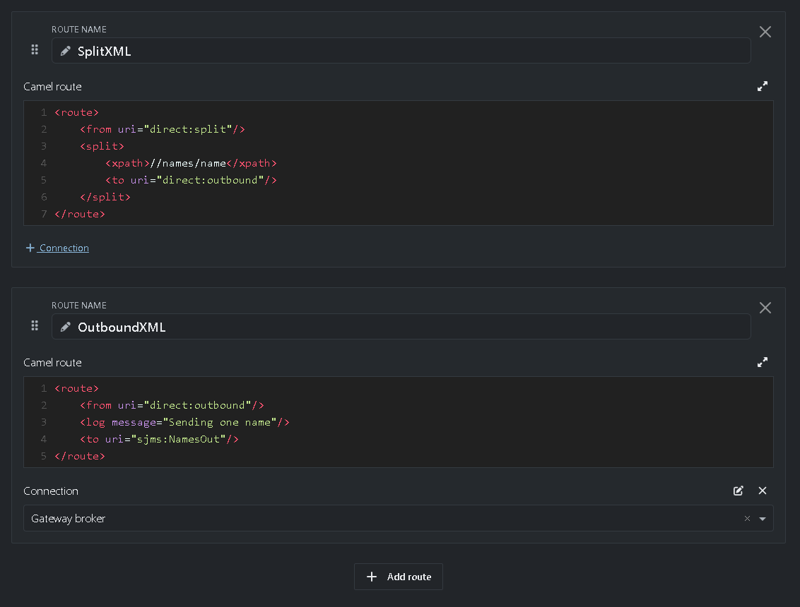
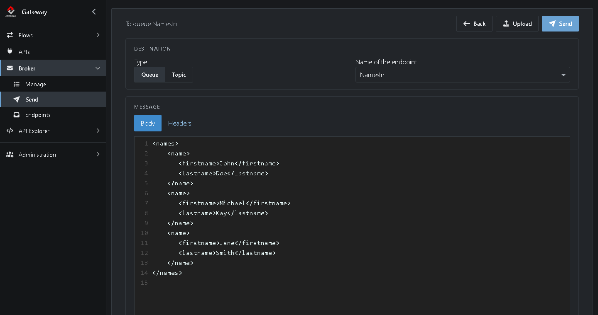
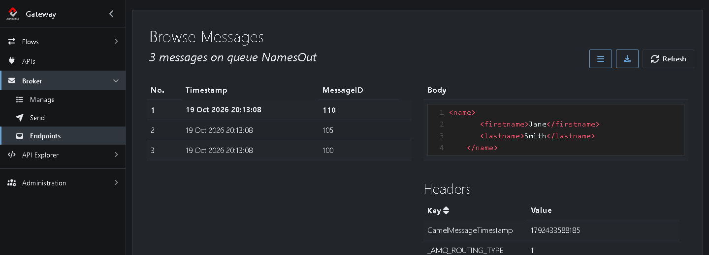

# Tutorial 8: A route with queues and a split

<!-- tutorial: {"id":"tutorial8","wiki":"tutorial6-routes-with-split","title":"Tutorial 8: A route with queues and a split","minutes":15,"track":"For Camel developers"} -->

**What you'll learn**

* Combine three routes in one Flow
* Read from and write to queues in a route
* Split a message into one per item

It takes about 15 minutes.

<!-- web-only -->
> You can also follow this tutorial inside the Gateway: click **Tutorials** in the menu. It shows each step next to the screen it's about and ticks it off once you've done it.

## Before you start

* [Tutorial 7](https://github.com/assimbly/gateway/wiki/tutorial6-simple-route), so you know the route editor
* The built-in broker running, with its Connection *Gateway broker* (or your own Connection from [Tutorial 6](https://github.com/assimbly/gateway/wiki/tutorial6-message-queueing))

## How it works

The Flow *SplitNames* takes a list of names from a queue, splits it into one message per name, and puts each name on another queue. It has three routes. They pass messages to each other with `direct:` endpoints, which connect routes within the same Gateway:

**InboundXML:** queue *NamesIn* → `direct:split`

**SplitXML:** `direct:split` → split into one message per `<name>` → `direct:outbound`

**OutboundXML:** `direct:outbound` → queue *NamesOut*

You could write it all in one route. Splitting it up keeps each route small, and you can reuse a route, such as *SplitXML*, from other routes.

## Step 1: Create the Flow

<!-- step: {"check":"route:editor=route"} -->

1. Go to **Flows → Manage**, click **Add** <!-- show: [aria-label="Add"] --> and choose **Camel route**. <!-- show: a.flow-type-choice[href*="editor=route"] -->
2. Next to **Flow name**, type `SplitNames`. <!-- show: #field_flowName -->
3. Set **Route name** to `InboundXML`. <!-- show: [formcontrolname="routeName"] -->

The **Error handler** tab holds a route for failed messages. Leave it empty: it's not one of the three routes.

## Step 2: Write the inbound route

1. Replace the example route in the **Camel route** field of *InboundXML* with this route: <!-- show: [data-tour="route-content"] -->

   ```xml
   <route>
       <from uri="sjms:NamesIn"/>
       <log message="Received a list of names"/>
       <to uri="direct:split"/>
   </route>
   ```

   It takes each message from the queue *NamesIn* and passes it on to `direct:split`.

2. Click **+ Connection** under the route. <!-- show: [data-tour="step-add-connection"] --> A **Connection** field appears.
3. In **Connection**, choose *Gateway broker*. <!-- show: [formcontrolname="connection"] -->



> The JMS endpoints of a route (`sjms:`, `sjms2:`, `jms:` and `activemq:`) use the Connection you choose here. Only when an endpoint needs another Connection, you name that one in the URI yourself, with `connectionFactory=#<id>`. You find a Connection's id with the **Edit connection** icon above the **Connection** field.

## Step 3: Write the split route

1. Click **Add route** under *InboundXML*. <!-- show: [data-tour="step-add"] --> A new route appears under it.
2. Set **Route name** to `SplitXML` and copy this route into its **Camel route** field:

```xml
<route>
    <from uri="direct:split"/>
    <split>
        <xpath>//names/name</xpath>
        <to uri="direct:outbound"/>
    </split>
</route>
```

The `<split>` uses the [XPath](https://camel.apache.org/components/latest/languages/xpath-language.html) expression `//names/name` to find every `<name>` element in the message. Each one becomes a message of its own and goes to `direct:outbound`.

## Step 4: Write the outbound route

<!-- step: {"check":"flowStatus:SplitNames:started"} -->

1. Click **Add route** under *SplitXML*. A new route appears under it.
2. Set **Route name** to `OutboundXML` and copy this route into its **Camel route** field:

```xml
<route>
    <from uri="direct:outbound"/>
    <log message="Sending one name"/>
    <to uri="sjms:NamesOut"/>
</route>
```

3. Click **+ Connection** under *OutboundXML* and select *Gateway broker*. Each route that uses a queue needs a Connection, so this route needs one too.



4. Click **Save & Test**. <!-- show: [data-tour="flow-save-test"] --> It saves the Flow, starts it and switches to **Test**.

You don't need to create the queues *NamesIn* and *NamesOut*: the broker creates them the first time a route uses them.

## Step 5: Send a list of names

<!-- step: {"check":"queueMessages:NamesOut"} -->

1. Go to **Broker → Endpoints**. You see *NamesIn* with 1 consumer: your *InboundXML* route. (Don't see it? The filter box keeps what you typed last time, such as `Orders` from Tutorial 6. Clear it with **×**.)
2. Click **Send** in the row of *NamesIn*. <!-- show: tr[data-endpoint-name="NamesIn"] [aria-label="Send"] -->
3. Paste this XML into the **Body**: <!-- show: .body-codemirror -->

   ```xml
   <names>
       <name>
          <firstname>John</firstname>
          <lastname>Doe</lastname>
       </name>
       <name>
          <firstname>Michael</firstname>
          <lastname>Kay</lastname>
       </name>
       <name>
          <firstname>Jane</firstname>
          <lastname>Smith</lastname>
       </name>
   </names>
   ```



4. Click **Send**. <!-- show: [title="Send (Ctrl+Enter)"] -->

## Step 6: See the result

<!-- step: {"check":"route:endpointName=NamesOut"} -->

1. Go to **Broker → Endpoints** and type `Names` in the filter box.


The one message you sent to *NamesIn* is gone. *NamesOut* has 3 more messages: one per name.

2. Click **NamesOut** to browse them. <!-- show: tr[data-endpoint-name="NamesOut"] td a --> Each message holds one `<name>`:



When you're done, stop *SplitNames*: on **Flows → Manage**, click **■** in its row. To remove the test messages, use **⋮** → **Clear** on *NamesOut*.

## Summary

| Route | Reads from | Does | Writes to |
|-------|-----------|------|-----------|
| *InboundXML* | queue *NamesIn* | Logs a line | `direct:split` |
| *SplitXML* | `direct:split` | Splits on `//names/name` | `direct:outbound`, once per name |
| *OutboundXML* | `direct:outbound` | Logs a line | queue *NamesOut* |

**Done!** You built a Flow of three routes with queues and a split. Continue with [Tutorial 9: Running scripts](https://github.com/assimbly/gateway/wiki/tutorial6-running-scripts).
