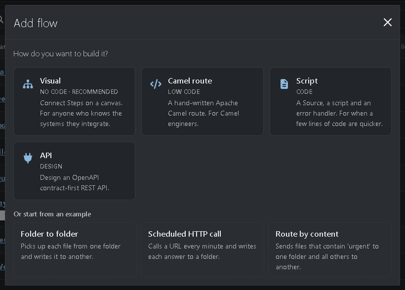
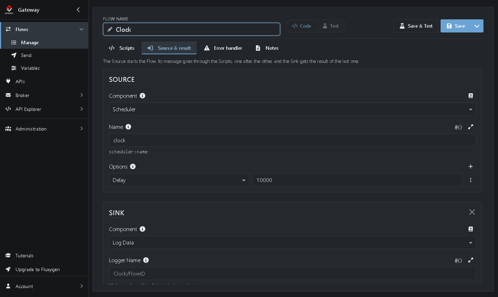
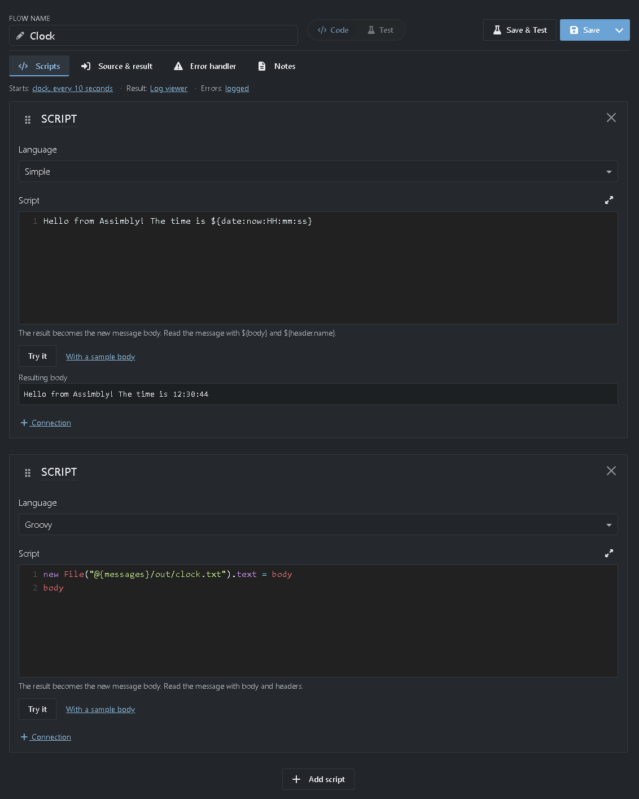
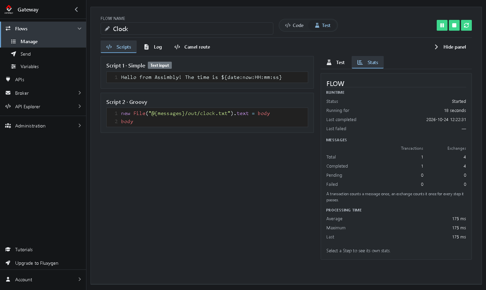

# Tutorial 9: Running scripts

<!-- tutorial: {"id":"tutorial9","wiki":"tutorial6-running-scripts","title":"Tutorial 9: Running scripts","minutes":10,"track":"For Camel developers"} -->

**What you'll learn**

* Create a Script Flow
* Write scripts in Simple and Groovy
* Chain scripts one after another

It takes about 10 minutes.

<!-- web-only -->
> You can also follow this tutorial inside the Gateway: click **Tutorials** in the menu. It shows each step next to the screen it's about and ticks it off once you've done it.

## How it works

A **Script** Flow runs your own scripts, for when a few lines of code are quicker than a Flow of Steps. You build a small clock: every 10 seconds one script writes a greeting with the current time, and a second script saves it to a file.

**Scheduler (Source)** → **Simple (Script)** → **Groovy (Script)** → **Log Data (Sink)**

> **What are the parts of a Script Flow?**
>
> * The **Source** starts the Flow, like in a visual Flow. A new Script Flow starts with **Once**, which sends one message when the Flow starts.
> * A **Script** runs your script. Its result becomes the message. With more Scripts, each one gets the message the one before it made.
> * The **Sink** takes the result of the last script. By default it's **Log Data**, which writes each result to the log.
> * The **Error handler** takes care of a message when a script fails. By default it writes the error to the Gateway log.

> **Which languages?** Camel's Simple language, Groovy, JavaScript, Python, JSLT and XSLT.

## Step 1: Create a Script Flow

<!-- step: {"check":"route:editor=script"} -->

1. Go to **Flows → Manage** and click **Add**. <!-- show: [aria-label="Add"] -->
2. Choose **Script**. <!-- show: a.flow-type-choice[href*="editor=script"] -->

The script editor opens on the **Scripts** tab.



> **What's on the other tabs?** **Source & result**, **Error handler** and **Notes** hold the other parts. The line above the scripts sums them up: *Starts: hello, once when started · Result: Log viewer · Errors: logged*.

## Step 2: Set the Source

1. Next to **Flow name**, type `Clock`. <!-- show: #field_flowName -->
2. Click the **Source & result** tab. <!-- show: [data-cy="script-tab-source"] -->
3. Under **Source**, click **Component**, type `sched` and choose **Scheduler**. <!-- show: [formcontrolname="componentType"] -->
4. Set **Name** to `clock`. <!-- show: [formcontrolname="uri"] -->
5. Under **Options**, choose **Delay** and type `10000`. <!-- show: .option-row -->



> **Why 10000?** The delay is in milliseconds, so the scripts run every 10 seconds. You know the Scheduler from [Tutorial 3](https://github.com/assimbly/gateway/wiki/tutorial6-calling-a-rest-api). The **Name** is just a name for it.

## Step 3: Write a script in Simple

1. Click the **Scripts** tab. <!-- show: [data-cy="script-tab-scripts"] -->
2. Set **Language** to **Simple**.
3. Replace the example in the **Script** field with: <!-- show: [data-tour="script-content"] -->

   ```
   Hello from Assimbly! The time is ${date:now:HH:mm:ss}
   ```

4. Click **Try it**. <!-- show: [data-tour="script-try"] -->

**Resulting body** shows what the script makes, such as `Hello from Assimbly! The time is 14:05:10`.

> **How does Simple work?** [Simple](https://camel.apache.org/components/latest/languages/simple-language.html) is Camel's own small expression language. The text is copied as it is, and every `${...}` is replaced: `${date:now:HH:mm:ss}` by the current time.

> **Does Try it start the Flow?** No. It only runs the script, so you can check it first.

## Step 4: Add a script in Groovy

<!-- step: {"check":"flowExists:Clock"} -->

1. Click **Add script** under the script. A second **Script** appears, in **Groovy**.
2. Type this in its **Script** field:

   ```groovy
   new File("@{messages}/out/clock.txt").text = body
   body
   ```

3. Click **Save**. <!-- show: [data-tour="flow-save"] -->



> **What does this script do?** In a script, `body` is the message: the greeting the Simple script made. The first line writes it to `clock.txt` in `@{messages}/out`. The second line, `body`, is the result of the script, so the message stays the same.

> **Which language when?** **Simple** to build text from the message and its headers. **Groovy**, **JavaScript** or **Python** when you need real code. **JSLT** to transform JSON and **XSLT** to transform XML.

## Step 5: Start the Flow and read the result

<!-- step: {"check":"flowCompleted:Clock"} -->

1. Click **Save & Test**. <!-- show: [data-tour="flow-save-test"] -->

Every 10 seconds the scripts run, and the **Stats** tab <!-- show: [data-cy="panel-stats"] --> counts a run under **Completed**.



2. Open `clock.txt` in `@{messages}/out`. Open it again a little later: the time has changed.
3. Click the **Log** tab. <!-- show: [data-cy="test-view-log"] --> The Sink wrote each greeting there, after `Body:`.
4. When you're done, click **■** (Stop). <!-- show: [data-tour="flow-status-controls"] --> Otherwise the Flow keeps writing the file.

> **Where is `@{messages}/out`?** The `out` folder in your messages folder, such as `C:\Users\<you>\messages\out` on Windows. The Variable `messages` under **Flows → Variables** holds its path.

> **Try it yourself**
>
> * Add the date: click **Code**, <!-- show: [data-cy="mode-toggle"] --> change the Simple script to `Hello from Assimbly! It is ${date:now:yyyy-MM-dd HH:mm:ss}` and click **Save & Test**. <!-- show: [data-tour="flow-save-test"] -->
> * Click **Run** in the *Test* panel. Each Script shows what it made of the message, under **Resulting body**.
> * Break the Groovy script on purpose, for example by writing to a folder that doesn't exist. **Failed** goes up on the **Stats** tab and an **Alerts** badge appears. [Tutorial 2](https://github.com/assimbly/gateway/wiki/tutorial6-debugging-a-flow) shows how to find the error.

## Summary

| Step | Language | What it does |
|------|----------|--------------|
| Source | **Scheduler** | Starts the Flow every 10 seconds (**Delay** `10000`). |
| Script | **Simple** | Makes the greeting with the current time. The result becomes the message. |
| Script | **Groovy** | Writes the message (`body`) to `clock.txt` and keeps it as the result. |
| Sink | **Log Data** | Writes each result to the log. |

**Done!** You ran your first scripts. In the last tutorial you control the Gateway without the browser: [Tutorial 10: Using the API](https://github.com/assimbly/gateway/wiki/tutorial6-using-the-api).
